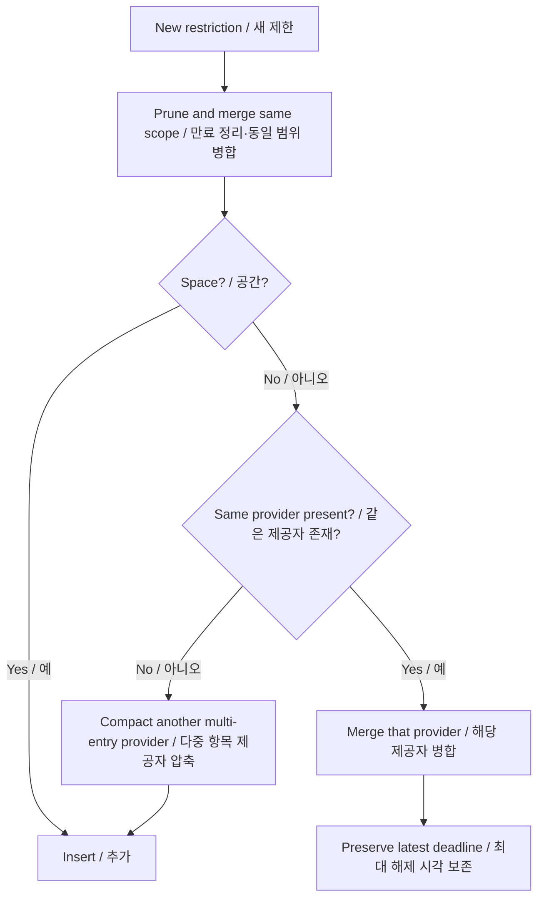
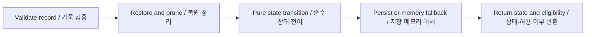
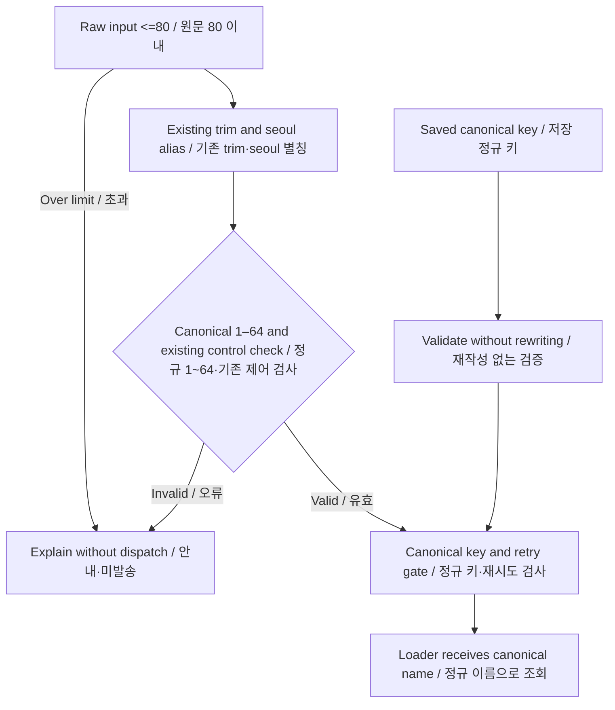

# Retry State Implementation Specification
# 재시도 상태 구현 명세

## Implementation result — 2026-11-18
## 구현 결과 — 2026-11-18

User approved and implemented retryState.ts, retryStorage.ts, and their tests. The runtime shape uses key/phase/spentRetries/requestId/dispatchedAt/timeoutMs/nextEligibleAt/expiresAt; expiry captures result-handled or synthetic completion without separately storing resultHandledAt. Conditions are empty in this first allowlisted representative-area implementation. Configured lifetime must be at least 60 seconds to preserve all stage waits. Configurations changing an active pending lifetime may invalidate those records; configuration migration is not implemented. StoragePort is injected so sessionStorage access is performed by a future caller. Storage snapshots are pruned in memory; callers must save the returned state to persist cleanup.
사용자 승인 후 retryState.ts·retryStorage.ts·테스트를 구현했습니다. 실행 형식은 key/phase/spentRetries/requestId/dispatchedAt/timeoutMs/nextEligibleAt/expiresAt이며 resultHandledAt을 별도 저장하지 않고 결과 처리 또는 합성 종료 기반 만료를 보존합니다. 첫 허용 목록 대표 지역 구현의 conditions는 빈 문자열입니다. 모든 단계 대기를 보존하려고 유효기간 설정은 최소 60초를 요구합니다. 활성 진행 중 유효기간 설정을 변경하면 기록 검증에 실패할 수 있으며 설정 이전은 구현하지 않았습니다. StoragePort를 주입하므로 sessionStorage 접근은 후속 호출자 담당입니다. 정리는 메모리 상태에서 수행하며 호출자가 반환 상태를 저장해야 영속 정리가 반영됩니다.

Measured: frontend 59 tests passed (11 new), TypeScript and production build passed. No App/network/cache wiring or actual adapter browser integration test in this implementation. Earlier standalone Chromium experiment is separate evidence. Module callers must provide validated snapshots and current clock values; these are not a server security limiter.
실측: Frontend 59개(신규 11개)·TypeScript·배포 빌드 통과. 이번 구현은 App·네트워크·캐시 연결과 실제 어댑터 브라우저 연동 테스트를 포함하지 않습니다. 이전 Chromium 독립 실험은 별도 근거입니다. 모듈 호출자는 검증된 상태·현재 시각을 제공해야 하며 서버 보안 제한이 아닙니다.

## Adopted configuration constraint
## 채택된 설정 제약

The user requires supported provider count <= restriction-entry limit (initially 20). Validate unique allowlisted provider IDs before accepting configuration. Reject an over-limit configuration; never silently drop providers or valid restrictions. If each provider already occupies one restriction entry, adding a new provider is a supported-list change and requires prior capacity review. This constraint and the provider-scoped merge algorithm below are adopted.
사용자 지시로 지원 제공자 수는 제한 항목 상한(초기 20개) 이하여야 합니다. 설정 수용 전에 허용 목록의 고유 제공자 ID 개수를 검증합니다. 초과 설정은 거부하고 제공자나 유효 제한을 조용히 삭제하지 않습니다. 제공자마다 제한 한 항목씩 있는 상태에서 새 제공자 추가는 지원 목록 변경으로 다루고 상한 검토를 선행합니다. 이 제약과 아래 제공자 단위 병합 알고리즘은 채택됐습니다.

Configuration acceptance tests: 19 and 20 unique providers pass; 21 fail. Duplicate IDs are configuration errors rather than a way to alter counting. Changing capacity or supported IDs requires revalidation before activation.
설정 완료 조건: 고유 제공자 19·20개는 통과하고 21개는 실패합니다. 중복 ID는 개수 조정 수단이 아닌 설정 오류입니다. 상한·지원 ID 변경 시 활성화 전에 재검증합니다.

Status: design adopted; code implementation is not approved. The adjustable 30-minute lifetime is a user-adopted initial assumption, not an official provider value or measured optimum.
상태: 설계 채택 완료이며 코드 구현은 승인 전입니다. 사용자는 조정 가능한 중간 흐름 30분을 초기 가정으로 채택했으며 공식 제공자 기준·실측 최적값이 아닙니다.

## Proposed scope and files
## 제안 범위와 파일

| Path / 경로 | Action / 작업 | Purpose and execution / 목적·작동 |
|---|---|---|
| frontend/src/state/retryState.ts | Create after approval / 승인 후 생성 | Pure transitions and eligibility calculations / 순수 전이·허용 시각 계산 |
| frontend/src/services/retryStorage.ts | Create after approval / 승인 후 생성 | Validate, restore, prune and persist records; memory fallback / 기록 검증·복원·정리·저장·메모리 대체 |
| frontend/src/tests/retryState.test.ts | Create after approval / 승인 후 생성 | Fake-clock transition and boundary tests / 가상 시계 전이·경계 검증 |
| frontend/src/tests/retryStorage.test.ts | Create after approval / 승인 후 생성 | Storage failure, corruption, retention and restoration tests / 저장 실패·손상·보존·복원 검증 |

Propose no App, network, or cache implementation in this first change. Pass the existing request timeout into the pure module; do not duplicate a hard-coded ten seconds. Wiring to the real client belongs to a subsequent plan.
첫 변경은 App·네트워크·캐시 구현을 포함하지 않는 안입니다. 기존 요청 제한을 순수 모듈의 인자로 받고 10초를 중복 하드코딩하지 않습니다. 실제 클라이언트 연결은 후속 계획입니다.

## Proposed record format
## 저장 형식 제안

- Envelope: version 1, flow records, and independent provider restriction records.
  - 바깥 형식: 버전 1·흐름 기록·독립 제공자 제한 기록입니다.
- Key: known provider ID, normalized representative area ID, data kind, canonical response-affecting conditions. No raw coordinates or credentials.
  - 키: 알려진 제공자 ID·정규화 대표 지역 ID·자료 종류·정규화한 응답 영향 조건입니다. 원본 좌표·인증정보는 제외합니다.
- Common flow fields: request key, state, spentRetries integer 0–2, nextEligibleAt, and optional intermediateExpiresAt where applicable.
  - 공통 필드: 요청 키·상태·사용 횟수 정수 0~2·다음 허용 시각·해당 중간 상태의 만료 시각입니다.
- Pending fields: request ID, attempt kind (initial/retry1/retry2), dispatchedAt, timeoutMs captured at dispatch. Do not persist live controllers or promises.
  - 진행 상태: 요청 ID·최초/재시도1/재시도2 구분·발송 시각·발송 당시 timeoutMs입니다. 실행 컨트롤러·Promise는 저장하지 않습니다.
- Completed intermediate state: resultHandledAt and expiry at resultHandledAt + configured flow lifetime.
  - 처리 완료 중간 상태: 결과 처리 시각과 해당 시각+설정 유효기간의 만료입니다.
- Adopted unknown-result intermediate expiry: dispatchedAt + timeoutMs + configured lifetime; final-attempt unknown results use dispatchedAt + timeoutMs + 60 seconds.
  - 결과 불명 중간 만료는 발송+timeoutMs+설정 유효기간이며 최종 시도 결과 불명은 발송+timeoutMs+60초로 채택됐습니다.

## Proposed validation and bounds
## 검증·상한 제안

### Accepted validation inputs and size experiment
### 채택한 검증 입력과 크기 실험

The user directed proceeding with these validation bounds: 20 flows, 20 independent provider restrictions, canonical keys at most 256 characters, request IDs at most 64 characters, and allowlisted provider/area/data-kind values. Arbitrary request conditions and raw errors are not stored. Unknown fields are rejected. These are starting validation assumptions, not measured optimal values.
사용자 지시로 검증 기준을 흐름 20개·독립 제한 20개·정규화 키 최대 256자·요청 ID 최대 64자·제공자/지역/자료 종류 허용 목록으로 정했습니다. 임의 요청 조건·원본 오류는 저장하지 않고 예상 외 필드는 거부합니다. 최적 실측값이 아닌 검증 시작 가정입니다.

Experiment on 2026-11-18: compact JSON with 20 pending-flow fixtures and 20 request-scoped restriction fixtures, maximum key/ID lengths, safe-integer timestamps. Python JSON serialization measured UTF-8 bytes and UTF-16 code units. This is a candidate-shape stress fixture, not proof of the maximum for the final TypeScript schema or browser storage usage.
2026-11-18 실험: 진행 흐름 20개·요청 범위 제한 20개·최대 키/ID 길이·안전 정수 시각을 compact JSON으로 직렬화했습니다. Python 직렬화의 UTF-8 바이트와 UTF-16 코드 단위를 측정했습니다. 최종 TypeScript 스키마의 최대값이나 브라우저 실제 사용량을 증명한 것이 아닌 후보 형식 스트레스 자료입니다.

| Fixture / 자료 | UTF-8 bytes / 바이트 | UTF-16 units / 코드 단위 |
|---|---:|---:|
| ASCII | 18,160 | 18,160 |
| Korean / 한글 | 41,040 | 18,160 |
| Emoji / 이모지 | 52,480 | 29,600 |
| Escaped control / 이스케이프 제어문자 | 75,360 | 75,360 |

The adopted application envelope limit is 96 KiB (98,304 UTF-8 bytes) plus at most 98,304 UTF-16 code units before parsing. The stress fixture leaves 22,944 bytes of headroom. This adjustable application cap is adopted; final-schema validation remains required. Reject control characters in canonical identifiers; use UTF-16 units consistently for length limits and a UTF-8 byte check after serialization. Emoji fixtures deliberately stress encoding beyond expected identifiers. Verify boundary minus one, exact boundary, and boundary plus one in the eventual JavaScript serializer tests. Real browser quota/access failures must still use the specified memory fallback.
앱 전체 형식 상한은 96KiB(UTF-8 98,304바이트), 해석 전 UTF-16 코드 단위도 최대 98,304로 채택했습니다. 스트레스 자료 대비 22,944바이트 여유입니다. 조정 가능한 앱 총상한은 채택됐으며 최종 스키마 검증은 필요합니다. 정규화 식별자는 제어문자를 거부하고 길이는 UTF-16 단위로 일관되게 검사하며 직렬화 후 UTF-8 크기도 확인합니다. 이모지 자료는 예상 식별자보다 넓은 인코딩 스트레스입니다. 향후 JavaScript 직렬화 테스트에서 경계 -1·정확한 경계·경계 +1을 검증해야 합니다. 실제 브라우저 용량·접근 실패는 메모리 대체 규칙을 따릅니다.

Accept only the supported version, enumerated states/keys, finite safe-integer nonnegative millisecond timestamps, and state-specific required fields. Check attempt-kind/count consistency, positive finite timeout, and chronological relationships. Never trust a record merely because JSON parsing succeeds.
지원 버전·열거 상태 및 키·유한한 안전 정수인 0 이상 밀리초 시각·상태별 필수 필드만 허용합니다. 시도 종류·횟수 일치, 양수 유한 timeout, 시각 순서를 확인합니다. JSON 해석 성공만으로 신뢰하지 않습니다.

The user accepted 20 flows as the initial validation bound. Prune expired/completed flows first. If all 20 are active, refuse another flow instead of evicting active limits. Preserve valid independent restrictions. Size/format failures return an explicit restore outcome. This validation bound does not authorize runtime implementation.
사용자가 흐름 20개를 검증용 초기 기준으로 채택했습니다. 만료·완료부터 정리하고 모두 활성 상태면 유효 제한을 제거하지 않고 새 흐름을 거부합니다. 유효 독립 제한은 보존하고 크기·형식 오류는 명시적 복원 결과로 반환합니다. 검증 기준 채택은 실행 구현 승인이 아닙니다.

Per-item corrupt-flow removal with preservation of valid independent restrictions is adopted; code implementation remains pending approval. Storage denial uses the already documented memory fallback. Client storage is not a security rate limiter. Same-tab persistence and cross-reload clock limitations must remain explicit.
손상 흐름 제거·유효 독립 제한 보존은 채택됐으며 코드 구현은 승인 전입니다. 저장 거부는 문서화된 메모리 대체를 사용합니다. 클라이언트 저장은 보안 호출 제한이 아니며 탭 범위·재진입 시계 한계를 명시합니다.

### Independent provider restriction proposal
### 독립 제공자 제한 제안

Each restriction contains version 1, a known provider ID, scope (provider or canonical request key), receivedAt, and blockedUntil. Provider scope is the conservative default when a verified response does not establish a narrower scope. It applies to this client's requests to that provider, not as a claim of cross-user enforcement. Store no credentials, raw coordinates, or raw upstream error text. A flow deletion must not delete this record.
제한 기록은 버전 1·알려진 제공자 ID·범위(제공자 전체 또는 정규화 요청 키)·수신 시각 receivedAt·해제 시각 blockedUntil을 가집니다. 검증된 응답이 좁은 범위를 확정하지 않으면 제공자 범위를 기본으로 제안합니다. 해당 클라이언트의 제공자 요청에 적용하며 사용자 간 통제 보장은 아닙니다. 인증정보·원본 좌표·원본 오류는 저장하지 않습니다. 흐름 삭제로 이 기록을 지우지 않습니다.

Validate supported version, known provider, allowed scope, key/provider consistency, safe-integer nonnegative timestamps, and blockedUntil >= receivedAt. Missing/invalid fields produce invalidRestriction; never invent a deadline. Valid expired restrictions are removed; valid future restrictions survive flow expiry/corruption. Repeated restrictions with the same scope retain the later blockedUntil. Invalid records cannot reconstruct a lost restriction; report the limitation and rely on separate backend control. Retry-After parsing remains an implementation gate outside this storage format.
지원 버전·알려진 제공자·허용 범위·키/제공자 일치·0 이상 안전 정수 시각·blockedUntil >= receivedAt을 검증합니다. 필드 누락·오류는 invalidRestriction으로 반환하고 해제 시각을 만들지 않습니다. 유효 만료 기록은 제거하고 유효 미래 제한은 흐름 만료·손상 후에도 보존합니다. 동일 범위의 반복 제한은 더 늦은 blockedUntil을 유지합니다. 손상 기록으로 잃은 제한을 복구할 수 없으므로 한계를 보고하고 서버 통제는 별도로 둡니다. Retry-After 해석은 이 저장 형식 밖의 구현 전 결정입니다.

### Capacity and recovery proposal
### 상한·복구 제안

Adopted provider-scoped overflow algorithm: prune expired entries; merge identical provider/scope using the later deadline; insert when space exists. At capacity, combine the incoming restriction and existing entries for that provider into one provider-wide restriction with the maximum deadline. If that provider has no entry, compact another provider with multiple entries first. Choose the eligible provider by stable provider-ID order for deterministic results. Do not discard valid deadlines or block unrelated providers. Mark broadened restrictions as an application merge, not a provider-issued global instruction. Supported-provider count must not exceed capacity.
채택한 제공자 단위 포화 알고리즘: 만료 정리·동일 제공자/범위의 더 늦은 시각 병합 후 공간이 있으면 추가합니다. 포화 시 새 제한과 같은 제공자의 기존 항목을 최대 해제 시각의 제공자 전체 제한 하나로 합칩니다. 해당 제공자 항목이 없으면 여러 항목을 가진 다른 제공자를 먼저 압축합니다. 재현성을 위해 후보 중 제공자 ID의 고정 순서로 선택하는 구현 규칙을 둡니다. 유효 해제 시각을 버리거나 무관한 제공자를 차단하지 않습니다. 넓어진 범위는 제공자의 전역 지시가 아닌 앱 병합으로 표시합니다. 지원 제공자 수는 상한 이하여야 합니다.

If a provider-wide entry already exists, incoming request-specific restrictions update that entry to the later deadline rather than adding a redundant entry. Revalidate persisted records against the current allowlist; unsupported-provider records return a configuration mismatch instead of being silently dropped.
제공자 전체 항목이 이미 있으면 새 요청별 제한은 중복 삽입하지 않고 더 늦은 시각으로 갱신합니다. 저장 기록은 현재 허용 목록과 재검증하며 미지원 제공자 기록은 조용히 삭제하지 않고 설정 불일치를 반환합니다.

The earlier all-provider overflow scalar is superseded and must not be implemented. Its historical size experiment remains evidence about the old candidate only. Final schema tests must measure the adopted merge metadata and all supported states before implementation acceptance.
이전 모든 제공자 전역 차단 필드는 폐기됐으며 구현하지 않습니다. 해당 필드의 과거 측정은 이전 후보에 대한 근거로만 보존합니다. 구현 완료 검증 전 최종 병합 메타데이터·모든 지원 상태의 크기를 측정해야 합니다.

## Verification history — superseded candidate
## 검증 이력 — 폐기된 후보 형식

These historical experiments used an earlier schema; they do not define current runtime behavior. The global overflow scalar is excluded from the adopted design.
이 실험은 이전 형식을 사용한 이력이며 현재 동작을 정의하지 않습니다. 전역 포화 필드는 채택 설계에서 제외합니다.

### JavaScript verification result — 2026-11-18
### JavaScript 검증 결과 — 2026-11-18

Node JSON.stringify and TextEncoder reproduced candidate UTF-8 sizes: ASCII 18,160; Korean 41,040; emoji 52,480; escaped control 75,360 bytes. The proposed predicate checks both string.length <= 98,304 and UTF-8 bytes <= 98,304. ASCII boundaries 98,303/98,304/98,305 yielded accept/accept/reject. Korean boundaries 98,301/98,304/98,307 bytes yielded accept/accept/reject. These used stress strings, not valid schema records; they verify only the size predicate. At that experiment stage, final-schema and browser tests were pending; the later Chromium results below supersede that status. The current 96-KiB application cap is adopted.
Node JSON.stringify·TextEncoder로 후보 UTF-8 크기 ASCII 18,160·한글 41,040·이모지 52,480·제어문자 75,360바이트를 재현했습니다. 검사식은 문자열 길이와 UTF-8 크기 모두 98,304 이하를 요구합니다. ASCII 98,303/98,304/98,305는 허용/허용/거부, 한글 98,301/98,304/98,307바이트도 허용/허용/거부였습니다. 유효 스키마 기록이 아닌 스트레스 문자열이므로 크기 검사식만 검증합니다. 당시에는 최종 스키마·브라우저 검증 전이었으며 아래 후속 Chromium 결과로 해당 상태를 갱신했습니다. 현재 96KiB 앱 상한은 채택됐습니다.

After pruning expired/completed flows, an existing key may still update or retry under its own limits even when all 20 slots are occupied. A new key returns capacityBlocked without dispatch or insertion. Return current/max counts and earliestFlowExpiryAt when a valid expiry is known; do not invent a fixed recovery countdown when none is known. Keep the existing entries and independent restrictions. Recovery occurs after normal completion/cancellation-policy cleanup or expiry frees a slot; merely opening the screen does not extend retention.
만료·완료 흐름 정리 후 20개가 차도 기존 키는 자기 제한에 따라 갱신·재시도할 수 있습니다. 새 키는 발송·삽입 없이 capacityBlocked를 반환합니다. 현재/최대 개수와 유효 만료가 확인될 때 earliestFlowExpiryAt을 반환하며 모르면 임의 복구 카운트다운을 만들지 않습니다. 기존 항목·독립 제한은 보존합니다. 정상 완료·취소 정책에 따른 정리·만료로 자리가 생기면 복구하며 화면 열기로 보존 기간을 연장하지 않습니다.

Capacity is distinct from storageUnavailable (access/quota failure), invalidRecord (malformed flow), and providerBlocked (active provider restriction). Storage failure uses memory fallback but retains the same 20-flow logical cap and known restrictions; it does not justify clearing active entries. A free slot alone does not authorize a request if another wait remains. These outcomes must be returned to callers for future UI wiring; this first module does not render messages.
상한은 storageUnavailable(접근/저장 용량 오류)·invalidRecord(흐름 손상)·providerBlocked(유효 제공자 제한)와 구분합니다. 저장 오류는 메모리로 대체하되 20개 논리 상한·알려진 제한을 유지하고 활성 항목 삭제 근거로 삼지 않습니다. 자리가 생겨도 다른 대기가 남으면 요청을 허용하지 않습니다. 결과는 후속 화면 연결을 위해 호출자에게 반환하며 첫 모듈은 안내 화면을 만들지 않습니다.

Additional tests: cross-flow provider blocking, request-scope isolation, later-deadline merge, restriction expiry/corruption, existing-key updates at capacity, new-key refusal, recovery after expiry/completion, unknown recovery time, and quota failure without cap bypass.
추가 검증: 흐름 간 제공자 차단·요청 범위 격리·더 늦은 제한 병합·제한 만료/손상·상한 중 기존 키 갱신·새 키 거부·만료/완료 후 복구·복구 시각 불명·저장 용량 실패 시 상한 우회 없음입니다.
### Chromium storage experiment — 2026-11-18
### Chromium 저장 실험 — 2026-11-18

Chromium 159.0.8154.6, isolated page with intercepted test-origin HTML: a candidate envelope with 20 flows, 20 restrictions, maximum Korean key/ID lengths, and overflowBlockedUntil serialized to 41,080 UTF-8 bytes / 18,200 UTF-16 units. sessionStorage roundtrip and same-tab reload preservation passed. A 20-MiB write raised a real QuotaExceededError while preserving the earlier record. A standalone save wrapper switched to memory for that quota error and an injected SecurityError. Identifier checks accepted 256/64-unit boundaries, rejected 257/65 and control characters. The experiment used no live weather calls or user location.
Chromium 159.0.8154.6의 격리된 테스트 페이지에서 흐름 20개·제한 20개·최대 한글 키/ID·overflowBlockedUntil 후보를 측정해 UTF-8 41,080바이트/UTF-16 18,200단위를 확인했습니다. sessionStorage 저장·읽기와 같은 탭 새로고침 유지가 통과했습니다. 20MiB 쓰기는 실제 QuotaExceededError를 발생시켰고 이전 기록은 보존됐습니다. 독립 저장 래퍼는 실제 용량 예외와 주입 SecurityError에서 메모리 대체했습니다. 식별자 256/64단위 허용·257/65 및 제어문자 거부를 확인했습니다. 실 날씨 호출·사용자 위치는 사용하지 않았습니다.

Limitations: this is one Chromium environment, not all browsers. SecurityError was injected; actual browser access-denial settings were not tested. The candidate includes the overflow scalar but is not the final application schema. State-validator, overflow behavior, cancellation, and application adapter tests require the separately approved implementation. The adopted 96-KiB app cap is not a universal browser quota guarantee.
한계: Chromium 한 환경이며 모든 브라우저 검증이 아닙니다. SecurityError는 주입했고 실제 브라우저 접근 거부 설정은 검증하지 않았습니다. 포화 필드를 포함한 후보이나 최종 앱 스키마는 아닙니다. 상태 검증·포화 동작·취소·실제 어댑터 테스트는 별도 승인 구현이 필요합니다. 채택한 96KiB 앱 상한은 보편적 브라우저 저장 용량 보장이 아닙니다.
## Tests and acceptance proposal
## 테스트·완료 조건 제안

Test 5/15/60-second boundaries, maximum two retries, no automatic dispatch, dispatch/cancel accounting, stale request IDs, no_data completion, longer provider wait, exact cache-independent flow expiry, adjustable lifetime, reload without renewal, pending unknown results, malformed records, storage exceptions, and capacity refusal without eviction of active restrictions.
5/15/60초 경계·최대 2회·자동 발송 없음·발송 및 취소 집계·이전 요청 ID·no_data 종료·더 긴 제공자 대기·캐시와 별도 흐름 만료·유효기간 조정·재진입 시 연장 없음·진행 중 결과 불명·손상·저장 예외·유효 제한 제거 없는 상한 거부를 검증합니다.

Use injectable wall and monotonic clocks. Monotonic time controls waits during one page lifetime; restoration uses validated absolute timestamps. Across reloads, clock manipulation cannot be completely detected by this client-only design. Test detectable invalid ordering and document undetectable changes; do not claim security enforcement.
벽시계·단조 시계를 주입합니다. 동일 화면 대기는 단조 시계, 복원은 검증된 절대 시각을 사용합니다. 클라이언트만으로 재진입 사이 시계 조작을 완전히 탐지할 수 없습니다. 탐지 가능한 순서 오류를 검증하고 탐지 불가 변경 한계를 기록하며 보안 통제를 주장하지 않습니다.

Source: user-adopted policy and local client timeout. Next: review the final specification, then obtain implementation approval before creating source files.
출처: 사용자 채택 정책·로컬 클라이언트 제한입니다. 다음: 최종 명세를 검토한 뒤 소스 생성 전 구현 승인을 받습니다.

## Adoption status summary
## 채택 상태 요약

Adopted: adjustable 96-KiB app envelope cap, per-item corrupt-flow removal with valid restriction preservation, unknown-result timing based on dispatch plus captured timeout, first implementation limited to modules/storage/tests, and provider-scoped overflow merging. Historical experiments are separated above; adopted rules govern current design. Actual final-schema/browser integration validation remains required. No runtime code is authorized by documentation adoption alone.
채택: 조정 가능 96KiB 앱 전체 상한·손상 흐름 제거와 유효 제한 보존·발송+당시 timeout 기반 결과 불명 계산·모듈/저장/테스트의 첫 구현 범위·제공자 단위 포화 병합입니다. 과거 실험은 위 이력으로 분리했으며 현재 설계는 채택 규칙을 따릅니다. 최종 스키마·브라우저 연동 검증은 필요하며 문서 채택만으로 실행 코드를 승인하지 않습니다.

## UI wiring update — 2026-11-18
## 화면 연결 갱신 — 2026-11-18

The preceding module-only scope and approval statements describe the earlier implementation stage. The user subsequently approved UI integration. The hook now owns validated sessionStorage restoration, a monotonic page clock, dispatch-before-network persistence, cancellation and result settlement. App connects all individual entry points and a sequential overview.
위 모듈 전용 범위·승인 문구는 이전 구현 단계의 이력입니다. 이후 사용자가 화면 연결을 승인했습니다. 훅이 검증된 sessionStorage 복원·화면 단조 시계·통신 전 발송 저장·취소·결과 반영을 담당하고 App이 모든 개별 진입점과 순차 대표 목록을 연결합니다.

HTTP classification: network, timeout, input, auth, rate, server, invalid. Retry only network/timeout/rate/server and explicit provider_error. available/no_data/terminal remove the flow. Known request-scoped Retry-After restrictions remain independent. Mock HTTP 503 must carry provider_error; an invalid body is terminal. No last-selected-area restoration or background retry is implemented.
HTTP 분류: network·timeout·input·auth·rate·server·invalid입니다. network/timeout/rate/server와 명시적 provider_error만 재시도합니다. available/no_data/terminal은 흐름을 종료합니다. 알려진 요청 범위 Retry-After 제한은 독립적으로 유지합니다. Mock HTTP 503은 provider_error여야 하며 잘못된 본문은 종료 오류입니다. 마지막 선택 지역 복원·백그라운드 재시도는 없습니다.

Area input is trimmed and restricted to 64 UTF-16 units without controls; seoul maps to 서울. The decoder's configured area list includes bounded user-entered identifiers from the saved envelope; this does not expand official provider support. Provider remains mock and conditions remain empty. Stored retry keys include entered area names; no raw GPS coordinates or separately remembered selected area are stored.
지역 입력은 공백을 제거하고 제어문자 없이 UTF-16 64단위로 제한하며 seoul은 서울로 변환합니다. 디코더 설정 지역 목록은 저장 형식의 상한 있는 직접 입력 식별자를 포함하며 공식 제공자 지원 확대를 뜻하지 않습니다. 제공자는 mock·조건은 빈 문자열입니다. 저장된 재시도 키에는 입력 지역명이 포함되며 원본 GPS 좌표·별도 마지막 선택 지역은 저장하지 않습니다.

See [meeting and Mermaid](../office/meetings/2026-11-18-retry-ui-integration.md). Tests cover stage waits, duplicate suppression, timeout, reload, unknown results, request-scope isolation, storage failure and HTTP classification. Local Chromium checks the real Mock pipeline and reload retention. Live data, remote CI and browser-wide storage guarantees remain unverified.
[회의·Mermaid](../office/meetings/2026-11-18-retry-ui-integration.md)를 참조합니다. 단계 대기·중복 억제·시간 초과·재진입·결과 불명·요청 범위 분리·저장 실패·HTTP 분류를 검증합니다. 로컬 Chromium은 실제 Mock 파이프라인과 재진입 보존을 검사합니다. 실제 자료·원격 CI·모든 브라우저 저장 보장은 미검증입니다.

## Reviewed correction — shared clock and body errors
## 검토 보완 — 공유 시계와 본문 오류

The actual HTTP loader accepts (area, signal?, now?). The coordinator passes its epoch-anchored monotonic now callback. At 429 response handling, the adapter records receivedAt using that callback and computes a seconds-based Retry-After from receipt, not dispatch. HTTP-date remains an absolute epoch deadline, checked against the same callback. The coordinator persists these timestamps unchanged; injected adapters returning retryAt must use the supplied clock's epoch. With no callback, standalone HTTP calls default to Date.now.
실제 HTTP 로더는 (area, signal?, now?)를 받습니다. 조정자는 절대 시각 기준 단조 now 콜백을 전달합니다. 429 응답 처리 시 어댑터는 해당 콜백으로 receivedAt을 기록하고 초 단위 Retry-After를 발송 시점이 아닌 수신 시점부터 계산합니다. HTTP-date는 절대 마감 시각이며 같은 콜백으로 검사합니다. 조정자는 이 시각을 그대로 저장하며 retryAt을 반환하는 주입 어댑터는 전달된 시계의 기준을 사용해야 합니다. 콜백 없는 단독 HTTP 호출은 Date.now를 기본 사용합니다.

Read body text before parsing JSON and checking schema. Fetch/body-read transport failure is network, timeout is timeout, explicit external cancellation keeps its reason; JSON syntax or schema rejection is invalid. Only network/timeout retain the retry policy. Validation remains terminal. No automatic retry is introduced.
JSON 해석·스키마 검사 전에 본문 문자열을 읽습니다. fetch·본문 읽기 통신 실패는 network, 시간 초과는 timeout, 명시적 외부 취소는 사유를 보존하며 JSON 문법·스키마 거부는 invalid입니다. network/timeout만 기존 재시도 정책을 유지하고 검증 오류는 종료합니다. 자동 재시도는 추가하지 않습니다.

Re-review evidence and limitations: [correction meeting](../office/meetings/2026-11-18-retry-ui-corrections-review.md). Local results: 83 tests, TypeScript, build and five Chromium scenarios passed. Same-page wall-clock jumps are covered; initial clock accuracy and changes between reloads remain limitations.
재검토 근거·한계: [보완 회의록](../office/meetings/2026-11-18-retry-ui-corrections-review.md). 로컬 테스트 83개·TypeScript·빌드·Chromium 5개 통과. 같은 화면의 벽시계 변경은 검증했으며 초기 시계 정확성·재진입 사이 변경은 한계로 남습니다.

## 2026-11-19 — Adopted N80 contract and stage-3 implementation plan
## 2026-11-19 — 채택된 N80 계약과 3단계 구현 계획

The user's actual response "권고 진행" adopts the recommendation from [the stage-2 meeting](../office/meetings/2026-11-19-stage2-area-policy-selection.md). Contract status: adopted; source implementation status: pending approval. Earlier raw64/R proposals are discussion history, not the adopted rule. Existing source has not yet been changed to this plan.
사용자의 실제 응답 "권고 진행"에 따라 [2단계 회의](../office/meetings/2026-11-19-stage2-area-policy-selection.md)의 권고를 채택했습니다. 계약 상태: 채택·소스 구현 상태: 승인 대기. 앞선 원문 64/R 제안은 논의 이력이며 채택 규칙이 아닙니다. 기존 소스는 아직 이번 계획으로 바꾸지 않았습니다.

### Why / Goal / What
### 이유 / 목표 / 범위

Why: remove the frontend's unexplained 80/64 mismatch while preserving currently usable trimmed names and retry storage identities. Goal: the same raw input receives the same decision in the field and hook; invalid input does not dispatch an individual request or mutate retry records. What: frontend raw-input budget 80 UTF-16 units and canonical name bound 1–64 units, independent of backend's broader API contract.
이유: 기존 trim 입력·재시도 저장 식별자를 보존하며 Frontend의 설명 없는 80/64 불일치를 해소합니다. 목표: 같은 원문은 입력창·훅에서 같은 판정이며 잘못된 입력은 개별 조회 발송·재시도 기록 변경이 없습니다. 범위: Frontend 원문 UTF-16 80단위·정규 이름 1~64단위이며 Backend의 별도 API 계약과 독립입니다.

No backend change, new provider, cache, new Unicode normalization, broad name lowercasing, request-ID/provider limit coupling or stored-key migration. Preserve the 5/15/60-second retry policy and current storage bounds.
Backend 변경·새 제공자·캐시·새 Unicode 정규화·이름 전체 소문자화·요청 ID/제공자 상한 결합·저장 키 이전은 없습니다. 5/15/60초 재시도·현재 저장 상한을 유지합니다.

### How and execution order
### 방법과 실행 순서

1. A new pure areaInput service exports separate raw/name limits and one evaluator. Suggested result contract: success with canonical area, or failure with raw-too-long/empty/name-too-long/control reason. It has no React, storage or HTTP dependency.
   - 새 순수 areaInput 서비스가 원문/이름 상수와 평가 함수를 제공합니다. 결과 계약 제안: 정규 지역을 담은 성공 또는 원문 초과/빈 값/이름 초과/제어문자 사유의 실패. React·저장·HTTP 의존성은 없습니다.
2. Evaluate raw length first, rejecting over 80 without slicing. Apply existing trim and case-insensitive seoul-to-서울 alias. Reject empty or over-64 canonical names; retain the existing post-trim C0/DEL check. Leading/trailing whitespace handling is not silently tightened.
   - 먼저 원문 80 초과를 절단 없이 거부하고 기존 trim·seoul 대소문자 무관 서울 별칭을 적용합니다. 빈 값·정규 64 초과 거부·현재 trim 후 C0/DEL 검사를 유지합니다. 앞뒤 공백 처리를 조용히 강화하지 않습니다.
3. AreaSelector keeps a native raw cap of 80 through the shared constant, provides linked help and validates on explicit submission. If valid, pass the original raw value to the hook so the hook does not lose the raw-budget evidence. Invalid submissions retain editable text and show a reason without calling onSelect. Input edits alone never call the weather loader.
   - AreaSelector는 공유 상수로 기본 원문 상한 80을 유지하고 연결된 도움말·명시적 제출 검증을 제공합니다. 유효하면 원문 예산 근거를 잃지 않도록 훅에 원문을 전달합니다. 오류 제출은 편집할 원문·사유를 유지하고 onSelect를 호출하지 않습니다. 편집만으로 날씨 로더를 호출하지 않습니다.
4. The hook evaluates every individual entry, including injected Mock location, before key creation or retry transitions. Only successful canonical output becomes the request key and loader area. Raw text is not persisted or sent to the backend.
   - 훅은 주입 Mock 위치를 포함한 개별 진입을 키 생성·재시도 전이 전에 평가합니다. 성공한 정규 값만 요청 키·로더 지역으로 사용하며 원문은 저장·Backend 전달하지 않습니다.
5. Retry configuration and restored-name bounds reference only the name-limit constant. Restore validates stored keys exactly as stored; never trim, alias or rename them. Provider/kind/request-ID limits remain independent.
   - 재시도 설정·복원 이름 상한은 이름 상수만 참조합니다. 저장 키는 저장된 형태 그대로 검증하고 trim·별칭·이름 변경하지 않습니다. 제공자/종류/요청 ID 상한은 독립 유지합니다.

Help-text proposal for review: "앞뒤 공백은 제거합니다. 지역 이름은 최대 64단위, 입력 전체는 공백 포함 최대 80단위입니다. 이모지 등 일부 문자는 여러 단위로 계산됩니다." No new live counter or app-level composition slicing is proposed. Browser automation cannot establish every operating-system IME behavior.
안내 문구 검토안: "앞뒤 공백은 제거합니다. 지역 이름은 최대 64단위, 입력 전체는 공백 포함 최대 80단위입니다. 이모지 등 일부 문자는 여러 단위로 계산됩니다." 새 실시간 카운터·앱의 조합 중 임의 절단은 제안하지 않습니다. 브라우저 자동화로 모든 운영체제 입력기 동작을 보장할 수 없습니다.

### Exact file-change plan
### 정확한 파일 변경 계획

| Path / 경로 | Action after approval / 승인 후 작업 | Why, purpose and operation / 이유·용도·작동 |
|---|---|---|
| frontend/src/services/areaInput.ts | Create / 생성 | Shared pure input contract before any UI/hook side effect / UI·훅 부수 효과 전 공유 순수 입력 계약 |
| frontend/src/components/AreaSelector.tsx | Edit / 수정 | Shared raw cap, accessible help, submission validation and raw handoff / 공유 원문 상한·접근 가능한 도움말·제출 검증·원문 전달 |
| frontend/src/hooks/useWeatherRequest.ts | Edit / 수정 | Use shared evaluator before retry state and name constant in restore; preserve stored identity / 재시도 전 공유 평가·복원 이름 상수·저장 식별자 유지 |
| frontend/src/state/retryState.ts | Edit / 수정 | Name constant for area allowlist only; retain unrelated limits / 지역 허용 목록에만 이름 상수·무관한 상한 유지 |
| frontend/src/tests/areaInput.test.ts | Create / 생성 | Pure boundaries, trim/alias, controls and supplementary-character cases / 순수 경계·trim/별칭·제어문자·보충 문자 검증 |
| frontend/src/tests/App.test.tsx | Edit / 수정 | Real form invalid/no-dispatch, padded valid name and help association / 실제 폼 오류 미발송·공백 포함 유효 이름·도움말 연결 |
| frontend/src/tests/location-flow.test.tsx | Edit / 수정 | Injected raw80/81 and canonical64/65 decisions, not real GPS / 주입 원문 80/81·정규 64/65 판정·실제 GPS 아님 |
| frontend/src/tests/retryState.test.ts | Edit / 수정 | Area bound remains 64 without changing other config limits / 다른 설정 상한 변경 없이 지역 64 유지 |
| frontend/src/tests/retryStorage.test.ts | Edit / 수정 | Existing 64-unit keys retain counts/deadlines; malformed flow does not drop valid independent restrictions / 기존 64단위 키 횟수/마감·손상 흐름과 무관한 유효 제한 유지 |
| frontend/e2e/weather.spec.ts | Edit / 수정 | Actual browser raw cap, effective-name rejection and explicit padded-name submission / 실제 브라우저 원문 상한·이름 초과 거부·공백 이름 명시 제출 |
| README.md | Edit / 수정 | Explain runnable input rules and backend/source limitations / 실행 입력 규칙·Backend/출처 한계 안내 |
| docs/specs/weather-retry-state-implementation.md | Edit / 수정 | Record approved contract and actual implementation evidence / 승인 계약·실제 구현 근거 기록 |
| docs/office/change-report.md | Edit / 수정 | Every created/edited file's reason, execution and exact verification / 생성·수정 파일별 이유·실행·정확한 검증 |
| CONVERSATION_LOG.md | Edit / 수정 | Preserve outcomes and remaining approval gates / 결과·남은 승인 단계 보존 |

No deletion is planned. The preceding PR-rule and meeting-document edits stay in the same eventual commit bundle as requested; this plan does not execute that commit.
삭제 계획은 없습니다. 앞선 PR 규칙·회의 문서 수정은 요청한 추후 커밋 묶음으로 유지하며 이번 계획은 해당 커밋을 실행하지 않습니다.

### Acceptance criteria and verification
### 완료 조건과 검증

- Given canonical 63/64/65-unit names within raw80, when evaluated, accept 63/64 and reject 65. Given raw79/80/81 with a 64-unit name plus outer spaces, accept 79/80 and reject 81 without slicing.
  - 원문 80 이내 정규 이름 63/64/65에서 63/64 수용·65 거부. 64단위 이름에 외부 공백을 붙인 원문 79/80/81에서 79/80 수용·81 절단 없이 거부.
- Given " seoul ", when explicitly submitted, load 서울; whitespace-only is not sent. Keep current trim/control ordering; embedded surviving C0/DEL is rejected. No new Unicode normalization or broad case changes.
  - " seoul " 명시 제출은 서울 조회·공백만 미발송. 현재 trim/제어문자 순서 유지·정규 값에 남은 C0/DEL 거부. 새 Unicode 정규화·이름 전체 대소문자 변환 없음.
- Given 32/33 supplementary characters, validate UTF-16 64/66 correctly; length acceptance does not claim a valid geographic name.
  - 보충 문자 32/33개는 UTF-16 64/66으로 검증하며 길이 수용을 유효 지명으로 주장하지 않음.
- Given invalid manual or injected-location input, do not call the individual weather loader or mutate retry storage. Representative-overview calls must be excluded from the manual-request assertion.
  - 잘못된 직접 입력·주입 위치에서 개별 날씨 로더 호출·재시도 저장 변경 없음. 직접 요청 검증에서는 대표 목록 호출을 구분.
- Given valid stored canonical keys, restoration retains key text, retry count and eligibility unchanged; no key rewriting. Existing independent restrictions remain valid after unrelated corrupt-flow removal.
  - 유효 저장 정규 키의 복원은 키 문자열·횟수·허용 시각 유지·키 재작성 없음. 무관한 손상 흐름 제거 시 유효 독립 제한 유지.
- Component tests verify maxLength=80, help linked to the field, no implicit request on edits and retained text on rejection. Browser tests distinguish native limiting of paste/typing from explicit hook rejection; do not claim a synthetic change event proves native maxLength enforcement.
  - 컴포넌트는 maxLength=80·입력 도움말 연결·편집 시 자동 요청 없음·오류 원문 유지를 검증. 브라우저는 기본 붙여넣기/입력 제한과 훅의 명시적 거부를 구분하고 합성 change 이벤트로 기본 maxLength를 증명했다고 하지 않음.

After implementation approval: run frontend npm test, npm run typecheck, npm run build and npm run test:e2e with the existing backend/frontend setup. Report actual counts and failures rather than reusing previous 83/5 results. Review source and runtime behavior before requesting commit approval.
구현 승인 후 기존 Backend/Frontend 환경에서 npm test·npm run typecheck·npm run build·npm run test:e2e 실행. 이전 83/5 결과를 재사용하지 말고 실제 개수·실패를 보고합니다. 소스·실행 재검토 후 커밋 승인을 요청합니다.

Sources: stage-2 user response, meeting record, current source and self-authored fixtures. No new external material, dependency or license; live provider terms remain unverified. This section is an approved-policy/implementation-plan record, not a claim of implemented or tested runtime behavior.
출처: 2단계 사용자 응답·회의 기록·현재 소스·자체 자료. 새 외부 자료·의존성·라이선스 없음·실제 제공자 조건 미확인 유지. 이번 절은 채택 정책/구현 계획 기록이며 실행 구현·검증 완료 주장이 아닙니다.

## 2026-11-19 — N80 implementation result and technical review
## 2026-11-19 — N80 구현 결과·기술 검토

After the stage-3 plan was reported, the actual user response was "승인". This approves runtime implementation of the plan. Earlier pending-approval statements above describe the planning stage. Implemented the areaInput service and test, field validation/help, raw-value handoff, hook pre-transition evaluation and area-specific config/restore limits.
3단계 계획 보고 후 실제 사용자 응답은 "승인"이었습니다. 해당 계획의 실행 구현 승인입니다. 위 승인 대기 문구는 계획 단계의 이력입니다. areaInput 서비스·테스트·입력 검증/안내·원문 전달·훅 전이 전 평가·지역 전용 설정/복원 상한을 구현했습니다.

The evaluator returns ok/area or a raw_too_long, empty, name_too_long or control reason. The field and hook share the message mapping. The field passes valid raw text to the hook; the hook creates keys and calls the loader only with canonical output. Stored-key discovery uses only AREA_NAME_MAX_LENGTH, never the input evaluator. Provider/kind/request-ID limits stay independent.
평가는 ok/area 또는 raw_too_long·empty·name_too_long·control 사유를 반환하고 입력창·훅은 메시지 매핑을 공유합니다. 입력창은 유효 원문을 훅에 전달하고 훅은 정규 출력으로만 키 생성·로더 호출합니다. 저장 키 추출은 AREA_NAME_MAX_LENGTH만 사용하고 입력 평가를 사용하지 않습니다. 제공자/종류/요청 ID 상한은 독립 유지합니다.

Measured in the recovered working copy: offline npm ci restored existing locked dependencies; 112 tests passed (29 more than the prior 83), typecheck and build passed. Six Chromium scenarios passed, adding one N80 browser flow to the previous five. Tests include raw79/80 acceptance and raw81 rejection for a normalized64 name, canonical63/64/65, invalid manual/injected-location no-dispatch and unchanged retry storage, same existing trim/control behavior, supplementary characters and exact stored-key preservation.
복구 작업 복제본에서 실측: offline npm ci로 기존 잠금 의존성을 복원했고 테스트 112개(기존 83보다 29개 추가)·타입 검사·빌드 통과. 기존 5개에 N80 브라우저 흐름 1개를 더한 Chromium 6개 통과. 정규 이름 64에 원문 79/80 수용·81 거부·정규 63/64/65·잘못된 직접/주입 위치 미발송 및 저장 무변경·기존 trim/제어 동작·보충 문자·저장 키 정확 보존을 검증했습니다.

Technical self-review: no blocking finding identified in the implemented scope. Reviewed raw-budget enforcement before trim, shared field/hook acceptance, absence of slicing or broad case/Unicode changes, canonical-only transport/storage and non-normalizing restore. This is the assistant's technical review, not observer approval or commit authorization.
구현자 기술 재검토: 구현 범위에서 차단 지적을 발견하지 않았습니다. trim 전 원문 예산·입력창/훅 동일 판정·절단/이름 전체 대소문자/Unicode 변경 없음·정규 값만 전송/저장·복원 재정규화 없음을 확인했습니다. 어시스턴트의 기술 검토이며 관찰자 승인·커밋 허가가 아닙니다.

Limitations: unit-bound acceptance is not supported-geography validation; no live provider behavior or license was tested. Native Chromium insertion/typing was checked, but system clipboard, full real OS IME behavior and all browsers were not. Existing page/reload clock and client-only storage limitations remain.
한계: 길이 수용은 지원 지명 검증이 아니며 실제 제공자 동작·라이선스를 테스트하지 않았습니다. Chromium 기본 삽입/키 입력은 확인했지만 시스템 클립보드·실제 운영체제 입력기 전체·모든 브라우저는 미검증입니다. 기존 화면/재진입 시계·클라이언트 저장 한계는 유지합니다.

## Result-review report submitted
## 결과 검토 보고 제출

At the user's request, [the N80 result review](../office/meetings/2026-11-19-n80-result-review.md) compared the approved scope with implementation and recorded test evidence. Assistant technical assessment: no blocking finding identified; no source correction requested. No tests were rerun during this documentation-only review. The prior implementation-stage 112-test/6-browser-scenario evidence remains scoped to the covered cases. Actual user result acceptance and commit approval remain pending.
사용자 요청에 따라 [N80 결과 검토](../office/meetings/2026-11-19-n80-result-review.md)에서 승인 범위·구현·기록된 테스트 근거를 대조했습니다. 어시스턴트 기술 평가: 차단 지적 발견 없음·소스 수정 요청 없음. 문서 전용 검토에서 테스트를 재실행하지 않았으며 구현 단계 112개/브라우저 6개 근거는 해당 범위로 유지합니다. 실제 사용자 결과 수락·커밋 승인은 대기입니다.

## Actual user acceptance and commit authorization
## 실제 사용자 결과 수락·커밋 승인

The user subsequently replied "결과 수락, 커밋 승인". Result acceptance and the combined commit are authorized. Earlier pending-user-decision statements are review-time history. No further runtime change is part of this commit-preparation step; existing implementation evidence remains 112 frontend tests/typecheck/build/six Chromium passes. Push and PR authorization are not included.
이후 실제 사용자 응답 "결과 수락, 커밋 승인"에 따라 결과 수락·묶음 커밋을 승인받았습니다. 앞선 사용자 결정 대기는 검토 시점 이력입니다. 이번 커밋 준비에 추가 실행 변경은 없으며 기존 Frontend 112개/타입 검사/빌드/Chromium 6개 근거를 유지합니다. Push·PR 승인은 포함하지 않습니다.
