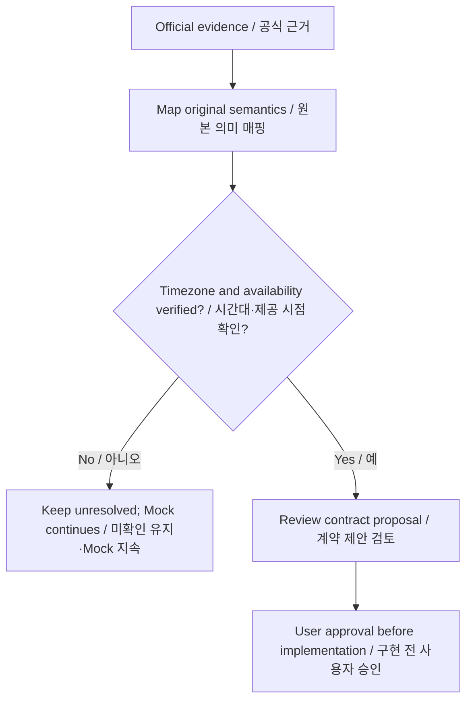

# Weather Timestamp Evidence Review
# 날씨 시각 근거 조사

## Attachment verification update
## 첨부 검증 갱신

The earlier attachment-reading limitation below is historical. Both the API Hub 260623 DOCX and the data.go.kr 2610 ZIP were downloaded and inspected. The ZIP contains a 261019 DOCX and a coordinate XLSX. The XLSX sheet is named 최종 업데이트 파일_20260930; its columns describe administrative codes, grid X/Y, and longitude/latitude, not API timestamp rules.
아래 첨부 읽기 한계는 이전 조사 상태입니다. API허브 260623 DOCX와 공공데이터포털 2610 ZIP을 내려받아 확인했습니다. ZIP에는 261019 DOCX와 좌표 XLSX가 있습니다. XLSX 시트명은 최종 업데이트 파일_20260930이며 열은 행정구역코드·격자 X/Y·위경도를 설명하므로 API 시각 명세가 아닙니다.

The 261019 DOCX retains observation calls after minute 10, nowcast calls after minute 45, and short-range forecast availability after minute 10 of its eight daily release hours. These are documented call schedules, not measured availability guarantees. Its observation request description uses ten-minute units, while the release table still lists hourly base_time examples; the generation sentence and table are also inconsistent. Do not infer the full set of accepted request times or sensor observation timestamps.
261019 DOCX는 실황 매시 10분 이후 호출·초단기예보 매시 45분 이후 호출·단기예보 하루 8회 발표의 10분 이후 제공 안내를 유지합니다. 문서상 호출 일정이며 실측 가동 보장이 아닙니다. 실황 요청 설명은 10분 단위이나 발표 표는 정시 base_time 예시를 사용하고 생성 문장과 표도 일치하지 않습니다. 허용되는 전체 요청 시각이나 센서 관측 시각을 추정하지 않습니다.

The official notice-list first page was checked through its 2026-11-03 entry; this is not an exhaustive historical notice audit. Latest listing attachment verified; global latest-version status, endpoint-specific timezone, and timing conflicts remain open. Next evidence must come from an official clarification or separately approved controlled API test; the coordinate workbook cannot resolve them.
공식 공지 목록 첫 페이지는 2026-11-03 항목까지 확인했으나 전체 과거 공지 감사는 아닙니다. 현재 목록 첨부는 확인했지만 전체 최신 버전 여부·endpoint별 시간대·시간 규칙 충돌은 미결정입니다. 다음 근거는 공식 해명 또는 별도 승인된 통제 API 테스트로 확보해야 하며 좌표 표로 해결할 수 없습니다.

Source: [official service listing](https://www.data.go.kr/data/15084084/openapi.do), attachment ID FILE_000000007732424, detail 1; [notice index](https://apihub.kma.go.kr/noticeList.do).
출처: 공식 서비스 목록의 첨부 식별자와 공지 목록입니다.

Checked: 2026-11-18 (Asia/Seoul). Status: partial research; contract proposal, not implementation.
확인일: 2026-11-18 (한국 시각). 상태: 부분 조사이며 계약 제안입니다.

<!-- Read evidence first, then proposed mappings, then unresolved gates. -->
<!-- 근거를 먼저 읽고 매핑 제안과 미해결 조건을 확인합니다. -->

## Sources and document versions
## 출처와 문서 버전

- [KMA data listing](https://www.data.go.kr/data/15084084/openapi.do): listing modified 2026-10-19; service VilageFcstInfoService_2.0.
  - 기상청 목록: 수정일 2026-10-19, 조사 서비스는 VilageFcstInfoService_2.0입니다.
- [KMA API Hub](https://apihub.kma.go.kr/apiList.do?seqApi=10): 260623 DOCX read; data.go.kr listing attachment 2610 ZIP and its 261019 DOCX also inspected. Timing conflicts remain unresolved.
  - API허브 260623 DOCX와 공공데이터포털 2610 ZIP의 261019 DOCX를 확인했습니다. 시간 규칙 충돌은 미해결입니다.
- [Open-Meteo API](https://open-meteo.com/en/docs) and [model updates](https://open-meteo.com/en/docs/model-updates): live pages; no immutable document version captured.
  - Open-Meteo 공식 API·모델 갱신 페이지: 고정 문서 버전은 확보하지 못했습니다.
- Current listing attachment verified; notice index first page checked. Exhaustive historical notices and global latest-version status remain unverified.
  - 현재 목록 첨부와 공지 첫 페이지는 확인했습니다. 과거 공지 전체와 전체 최신 버전 여부는 미검증입니다.

## Mapping proposals
## 매핑 제안

| Product / 상품 | Original field / 원본 | Meaning and proposed mapping / 의미·매핑 제안 | Remaining check / 남은 확인 |
|---|---|---|---|
| KMA observation / 기상청 실황 | baseDate + baseTime | Labeled publication time; preserve original, candidate issued_at / 발표 시각으로 설명됨, 원본 보존·issued_at 후보 | Sensor observation time and endpoint timezone / 실제 관측 시각·endpoint 시간대 |
| KMA forecast / 기상청 예보 | baseDate + baseTime | Publication reference → issued_at candidate / 발표 기준 → issued_at 후보 | Timezone before conversion / 변환 전 시간대 |
| KMA forecast / 기상청 예보 | fcstDate + fcstTime | Target time → valid_at candidate / 예보 대상 → valid_at 후보 | Timezone before conversion / 변환 전 시간대 |
| Open-Meteo current / 현재 모델 자료 | current.time | Valid time → valid_at candidate, not observed_at / 유효 시각 → valid_at 후보, 관측 시각으로 단정 금지 | Requested timezone configuration / 요청 시간대 설정 |
| Open-Meteo aggregates / 집계값 | current.interval | Backward aggregation duration in seconds / 이전 구간 집계 기간(초) | Variable-specific aggregation / 변수별 집계 의미 |
| Open-Meteo / 모델 자료 | generationtime_ms | Response-generation duration; never issued_at / 응답 생성 소요 시간, 발표 시각 매핑 금지 | None for this distinction / 이 구분은 확인됨 |
| Application / 애플리케이션 | Server clock / 서버 시계 | Candidate retrieved_at after successful fetch / 조회 성공 후 retrieved_at 후보 | Cache retrieval versus upstream fetch / 캐시 조회·외부 조회 구분 |

KMA numeric variable units and missing-value codes have not been fully extracted from the attachment. No numeric-field mapping is approved yet.
기상청 변수 단위·결측 코드는 첨부에서 완전히 추출하지 못했습니다. 숫자 필드 매핑은 아직 확정하지 않습니다.

## Availability and conflicts
## 제공 시점과 충돌

The data listing describes hourly base_time for observations; API Hub section 4 describes ten-minute units. Section 2 has separate gridded products with explicit KST. Do not transfer section 2 timing rules to section 4 without verification.
공공데이터포털은 실황 base_time을 정시로, API허브 4절은 10분 단위로 설명합니다. 2절은 KST를 명시한 별도 격자 상품입니다. 검증 없이 2절 규칙을 4절로 옮기지 않습니다.

Open-Meteo current values are model-based. A fifteen-minute data step is not the model release cadence. Model metadata updates do not directly identify the release of every Best Match response; no single staleness threshold is established.
Open-Meteo 현재 값은 모델 기반입니다. 15분 자료 간격은 모델 발표 주기가 아닙니다. 모델 갱신 메타데이터로 모든 Best Match 응답의 발표 버전을 직접 식별할 수 없으므로 공통 오래됨 기준은 정하지 않습니다.

For DST-aware display, propose Unix timestamps plus an IANA region timezone. KMA conversion remains gated on endpoint-specific timezone verification.
일광절약시간을 고려한 표시는 Unix timestamp와 IANA 지역 시간대 사용을 제안합니다. 기상청 변환은 endpoint별 시간대 확인 후 진행합니다.

## Role review
## 역할 검토

- Tech Lead proposes retaining Mock while evidence gaps remain; no schema change yet.
  - Tech Lead는 근거 공백 동안 Mock을 유지하고 스키마 변경을 보류하자고 제안합니다.
- Full-stack requires original timestamps and explicit missing values; no invented observation times.
  - Full-stack은 원본 시각과 명시적 결측을 요구하며 관측 시각을 만들지 않습니다.
- Researcher owns the remaining guide and notice checks.
  - Researcher가 가이드·공지의 남은 확인을 담당합니다.
- Legal requires service-specific terms, including third-party rights notices on the KMA listing, before live use.
  - Legal은 기상청 목록의 제3자 권리 표시를 포함한 서비스별 조건 확인을 요구합니다.
- Art Director and End User propose observation/forecast/model labels with explicit times instead of an unverified “latest” claim.
  - Art Director와 End User는 미검증 최신 표현 대신 관측·예보·모델 구분과 명시적 시각을 제안합니다.
- SecOps requires a separate authorized live-call stage; Trend Analyst limits overseas work to this comparison.
  - SecOps는 별도 승인 실호출 단계를 요구하며 Trend Analyst는 해외 범위를 이번 비교로 제한합니다.

## Contract and display proposal
## 계약·표시 제안

Preserve issued_at whenever genuinely supplied. Require valid_at for forecast/model values once timezone is verified. Require observed_at only when actual observation-time semantics are established. Server retrieval time cannot substitute for these fields. These are proposals and do not alter the current Mock contract.
실제로 제공된 발표 시각은 보존합니다. 시간대 확인 후 예보·모델 값에는 valid_at을 요구하는 방향입니다. 실제 관측 시각 의미가 확인된 경우에만 observed_at을 요구합니다. 서버 조회 시각은 이를 대체하지 않습니다. 제안이며 기존 Mock 계약은 바꾸지 않습니다.

Display candidates: “Forecast target”, “Model valid time”, and “Retrieved”. Observation labeling and freshness badges remain blocked pending evidence.
표시 후보: 예보 대상·모델 유효 시각·조회 시각입니다. 관측 표시와 최신성 배지는 근거 확인 전 보류합니다.

## Remaining work and verification
## 남은 작업과 검증

Remaining work: exhaustive change-notice checks, variable-specific units/missing-code extraction, unresolved endpoint timezone/timing semantics, and commercial service terms. The user deferred official inquiries and live calls; retain these gaps without inference.
남은 작업: 변경 공지 전체 확인·변수별 단위 및 결측 코드 추출·endpoint 시간대 및 시각 의미·상업 서비스 조건입니다. 사용자가 공식 문의와 실호출을 보류했으므로 추정 없이 공백으로 유지합니다.

## Research history
## 조사 이력

The first browser reader could not parse the attachment. A later direct download and text extraction succeeded, followed by inspection of the 2610 ZIP. This history is not the current verification status.
최초 브라우저 도구는 첨부를 읽지 못했지만 이후 직접 다운로드·본문 추출에 성공하고 2610 ZIP도 확인했습니다. 이 이력은 현재 검증 상태가 아닙니다.

Related meeting: [investigation scope](../office/meetings/2026-11-18-investigation-scope.md).
관련 회의: 위 조사 범위 회의록입니다.
