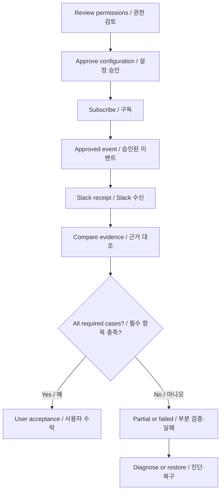

# Stage 1 — GitHub to Slack notifications
# 1단계 — GitHub에서 Slack으로 알림

## Adopted manual notification baseline / 채택된 수동 알림 기준

Actual user response: “회의 판단으로 채택”. [Adoption meeting](meetings/2026-11-19-manual-approval-notification-adoption.md) now governs the initial baseline over earlier proposal-only sections: manual one-time notification in the existing private channel; Curtain responds in the current Codex chat; record exact response/object/version and Slack permalink. No automatic sending or execution.
실제 응답: “회의 판단으로 채택”. [채택 회의](meetings/2026-11-19-manual-approval-notification-adoption.md)가 앞선 제안에 대해 초기 기준 확정: 기존 비공개 채널 수동 1회 알림·커튼 뒤 현재 Codex 채팅 응답·실제 응답/대상/버전/Slack permalink 기록. 자동 발송/실행 없음.

### S1-APPROVAL-20261119-01 v1 result accepted / 결과 수락

On 2026-11-20 KST, Curtain replied “이 결과 수락” in the current Codex chat. The acceptance covers the reviewer investigation and manual approval-waiting design in the [original Slack request](https://aihumanlearninglab.slack.com/archives/C0CJJLU6SK1/p1795068116069869). The manual flow now has a linked Slack notification, Codex response and repository record.
2026-11-20 KST에 커튼 뒤가 현재 Codex 채팅에서 “이 결과 수락”이라고 응답했습니다. 수락 범위는 [Slack 원문 요청](https://aihumanlearninglab.slack.com/archives/C0CJJLU6SK1/p1795068116069869)의 리뷰어 조사와 수동 승인 대기 설계입니다. Slack 알림·Codex 응답·저장소 기록이 연결됐습니다.

Stage 1 remains partially verified. The newly adopted review-related events are required but not yet verified; independent review decisions require a separate reviewer. Device push and recipient read status remain outside this event scope and unverified. Commit, Push and PR creation require separate authorization.
1단계는 부분 검증 상태입니다. 새로 필수 범위에 들어온 리뷰 관련 이벤트는 아직 검증되지 않았으며 독립 리뷰 판정에는 별도 리뷰어가 필요합니다. 기기 푸시와 수신자 읽음은 이번 이벤트 범위 밖이며 미검증입니다. 커밋·Push·PR 생성에는 별도 승인이 필요합니다.

## Beginner test plan / 초보자용 시험 계획

The test asks one simple question for each event: “Did the matching GitHub activity create the right message in the intended Slack channel?” GitHub is where the activity is recorded; Slack is where we look for the matching alert. Do not count the green `2/2` CI badge as proof of these notifications: it reports automated repository checks, a different kind of check.
시험은 이벤트마다 한 가지를 확인합니다: “GitHub에서 일어난 일이 맞는 Slack 알림을 만들었나?” GitHub에는 작업 기록이 있고 Slack에서는 그에 맞는 알림을 찾습니다. 초록색 `2/2` CI 표시는 이 알림의 증거가 아닙니다. 저장소 자동 검사 결과이며 다른 종류의 확인입니다.

**Plan review / 계획 점검 (2026-11-22):** The eight cases and evidence checks are clear enough to prepare. This is not approval to run live tests. Reuse existing Issue/PR evidence first. Before any live test, record for each case the GitHub repository and item number/title, event/review type, actor or reviewer, event time and timezone, GitHub source link, Slack channel and message permalink/display time, duplicate count, and result (`matched`, `not observed`, or `not run`). Do not invent a delivery-time limit. If no matching Slack message is found, record `not observed` with the time checked; do not mark the event as passed.
**계획 점검 (2026-11-22):** 여덟 시험 항목과 근거 확인 방법은 준비에 사용할 만큼 명확합니다. 이는 실제 시험 실행 승인이 아닙니다. 기존 Issue/PR 근거를 먼저 재사용합니다. 실제 시험 전 각 항목에 GitHub 저장소·항목 번호/제목·이벤트/리뷰 종류·작성자/리뷰어·이벤트 시각과 시간대·GitHub 원본 링크·Slack 채널과 메시지 permalink/표시 시각·중복 수·결과(`matched`, `not observed`, `not run`)를 기록합니다. 임의의 전달 시간 제한을 만들지 않습니다. 일치하는 Slack 메시지가 없으면 확인 시각과 함께 `not observed`로 기록하고 통과 처리하지 않습니다.

| Required event / 필수 이벤트 | Simple test action / 쉬운 시험 방법 | What must match / 대조할 내용 | Current status / 현재 상태 |
|---|---|---|---|
| Issue opened / Issue 생성 | Use an already recorded creation event first; do not create another Issue just to repeat the test.<br>먼저 기존 생성 기록을 사용하고 반복 시험만을 위해 Issue를 더 만들지 않습니다. | Same repository, Issue number/title, opened status and source link in GitHub and Slack.<br>GitHub·Slack의 저장소·Issue 번호/제목·열림 상태·링크 일치. | One earlier observation exists; reconcile its source and Slack evidence.<br>이전 관찰 1건 있음·원본/Slack 근거 대조 필요. |
| Issue closed / Issue 종료 | Use the existing Issue #23 closure evidence.<br>기존 Issue #23 종료 근거를 사용합니다. | The same Issue is closed in GitHub and Slack says it closed.<br>같은 Issue가 GitHub에서 닫혔고 Slack도 종료를 알림. | One earlier observation exists; reconcile its source and Slack evidence.<br>이전 관찰 1건 있음·원본/Slack 근거 대조 필요. |
| PR opened / PR 생성 | Use an existing PR-open notification before making a new PR.<br>새 PR을 만들기 전에 기존 생성 알림을 사용합니다. | Same repository, PR number/title, opened event and link.<br>저장소·PR 번호/제목·생성 이벤트·링크 일치. | PR #24/#26 evidence exists; reconcile against this record format.<br>PR #24/#26 근거 있음·이 기록 형식에 맞춰 대조 필요. |
| PR merged / PR 병합 | Use an existing merge notification before merging anything new.<br>새로 병합하기 전에 기존 병합 알림을 사용합니다. | Same PR and its merged status/link.<br>같은 PR의 병합 상태/링크 일치. | PR #24/#26 evidence exists; reconcile against this record format.<br>PR #24/#26 근거 있음·이 기록 형식에 맞춰 대조 필요. |
| Actions-submitted `COMMENT` / Actions 제출 `COMMENT` | First confirm an automation exists that submits a review marked `COMMENT`; then run it only on an approved test PR.<br>먼저 `COMMENT` 리뷰를 제출하는 자동화가 있는지 확인하고, 승인된 시험 PR에서만 실행합니다. | GitHub review says `COMMENT`, its actor is the automation, and Slack links to that same review/PR.<br>GitHub 리뷰가 `COMMENT`이고 작성 주체가 자동화이며 Slack이 같은 리뷰/PR을 가리킴. | Not implemented in the repository workflow inspected; do not treat the author's comment as a pass.<br>확인한 저장소 workflow에는 구현되지 않음·작성자 댓글을 통과로 보지 않음. |
| Review requested / 리뷰 요청 | A legitimate reviewer requests a review on an approved test PR.<br>정당한 리뷰어에게 승인된 시험 PR의 리뷰를 요청합니다. | GitHub shows the requested reviewer and Slack names the same PR/event.<br>GitHub 요청 리뷰어와 Slack 알림의 PR/이벤트가 일치. | Not tested; separate reviewer and an approved test PR are needed.<br>미시험·별도 리뷰어와 승인된 시험 PR 필요. |
| Independent `APPROVE` / 독립 승인 | The separate reviewer submits an approval on the approved test PR.<br>별도 리뷰어가 승인된 시험 PR을 승인합니다. | GitHub decision is `APPROVED`, reviewer is not the PR author, Slack matches the PR/reviewer.<br>GitHub 판정 `APPROVED`, 리뷰어는 PR 작성자가 아니며 Slack의 PR/리뷰어와 일치. | Not tested; a legitimate separate reviewer is needed.<br>미시험·정당한 별도 리뷰어 필요. |
| Independent `REQUEST_CHANGES` / 독립 수정 요청 | The separate reviewer requests changes on the approved test PR.<br>별도 리뷰어가 승인된 시험 PR에 수정 요청을 남깁니다. | GitHub decision is `CHANGES_REQUESTED`, reviewer is not the PR author, Slack matches the PR/reviewer.<br>GitHub 판정 `CHANGES_REQUESTED`, 리뷰어는 PR 작성자가 아니며 Slack의 PR/리뷰어와 일치. | Not tested; a legitimate separate reviewer is needed.<br>미시험·정당한 별도 리뷰어 필요. |

**Repository inspection:** the only tracked workflow found is `.github/workflows/quality-check.yml`. It runs quality checks for pushes, pull requests, or manual dispatch; it does not listen for review events or submit review comments. This means Actions-submitted `COMMENT` is not ready to test from the current repository workflow. The external GitHub App/Slack configuration was not inspected in this check.
**저장소 확인:** 추적 중인 workflow는 `.github/workflows/quality-check.yml` 하나입니다. 이 파일은 Push·Pull Request·수동 실행에 품질 검사를 하지만 리뷰 이벤트를 듣거나 리뷰 코멘트를 제출하지 않습니다. 따라서 현재 저장소 workflow로 Actions 제출 `COMMENT`를 시험할 준비가 되어 있지 않습니다. 이번 확인에서 외부 GitHub App/Slack 설정은 보지 않았습니다.

No live event should be generated until Curtain reviews this plan and separately approves execution. Creating a test PR, sending Slack messages, or involving another reviewer changes external state.
커튼 뒤가 이 계획을 검토하고 실행을 별도로 승인하기 전에는 실제 이벤트를 발생시키지 않습니다. 시험 PR 생성·Slack 메시지 발송·다른 리뷰어 참여는 외부 상태를 변경합니다.

## 2026-11-21 — PR #26 Slack receipt evidence / PR #26 Slack 수신 근거

The user-provided screenshot in the current conversation shows the private weather-conversation-app Slack channel with GitHub app messages for PR #26, “docs: improve Mermaid workflow diagrams and reporting”: one says the pull request was opened by cosohotmas, and another says it was merged by cosohotmas. The displayed repository, PR number and title match the merged PR. Record PR-open and PR-merged delivery as each observed once. The screenshot does not expose exact event timestamps or individual Slack permalinks, so no delivery-latency measurement is claimed. This is notification evidence, not an independent review or approval.
현재 대화에서 사용자가 제공한 스크린샷에는 비공개 weather-conversation-app Slack 채널과 PR #26 “docs: improve Mermaid workflow diagrams and reporting”에 대한 GitHub 앱 메시지가 보입니다. 하나는 cosohotmas가 Pull Request를 열었다고 표시하고, 다른 하나는 병합했다고 표시합니다. 저장소·PR 번호·제목은 병합된 PR과 일치합니다. PR 생성·병합 알림은 각각 1회 관찰로 기록합니다. 화면에 정확한 이벤트 시각과 개별 Slack permalink는 보이지 않아 전송 지연을 산출하지 않습니다. 이는 알림 근거이지 독립 리뷰나 승인이 아닙니다.

## Adopted mandatory event scope / 채택된 필수 이벤트 범위

On 2026-11-22, Curtain expanded the mandatory scope in the [review-notification scope adoption record](meetings/2026-11-22-review-notification-scope-adoption.md). The required events are Issue opened, Issue closed, PR opened, PR merged, Actions-submitted `COMMENT`, review requested, independent `APPROVE`, and independent `REQUEST_CHANGES`. Each event needs its own matching GitHub source and Slack message. A PR author's own comment does not count as an independent reviewer decision. User execution-approval notifications remain manual and separate from automated GitHub events.
2026-11-22 커튼 뒤가 [리뷰 알림 범위 채택 기록](meetings/2026-11-22-review-notification-scope-adoption.md)에서 필수 범위를 확대했습니다. 필수 이벤트는 Issue 생성, Issue 종료, PR 생성, PR 병합, Actions가 제출한 `COMMENT`, 리뷰 요청, 독립 `APPROVE`, 독립 `REQUEST_CHANGES`입니다. 각 이벤트는 GitHub 원본과 Slack 메시지를 따로 대조해야 합니다. PR 작성자 자신의 댓글은 독립 리뷰 판정으로 계산하지 않습니다. 사용자 실행 승인 알림은 수동 방식으로 자동 GitHub 이벤트와 분리합니다.

| Mandatory event / 필수 이벤트 | Current evidence / 현재 근거 | Evidence record fields / 근거 기록 필드 |
|---|---|---|
| Issue opened / Issue 생성 | Issue #23 matched once / Issue #23 한 건 대조 | Source/event and Slack message links, time/timezone, duplicate count, verdict / 원본·Slack 링크, 시각/시간대, 중복 수, 판정 |
| Issue closed / Issue 종료 | Issue #23 matched once / Issue #23 한 건 대조 | Same fields / 같은 필드 |
| PR opened / PR 생성 | PR #24 record and PR #26 Slack observation / PR #24 기록 및 PR #26 Slack 관찰 | Same fields / 같은 필드 |
| PR merged / PR 병합 | PR #24 record and PR #26 Slack observation / PR #24 기록 및 PR #26 Slack 관찰 | Same fields / 같은 필드 |
| Actions-submitted `COMMENT` / Actions 제출 `COMMENT` | Not yet verified; existing author-written comment is not proof / 미검증·기존 작성자 댓글은 증거 아님 | Confirm the submitted review is `COMMENT`, identify the Actions actor, and match its Slack message / 제출된 리뷰가 `COMMENT`인지와 Actions 주체를 확인하고 Slack 메시지 대조 |
| Review requested / 리뷰 요청 | Not yet verified / 미검증 | Match requested reviewer and PR to Slack notification / 요청된 리뷰어·PR과 Slack 알림 대조 |
| Independent `APPROVE` / 독립 승인 | Not yet verified; requires a separate reviewer / 미검증·별도 리뷰어 필요 | Match review decision, reviewer identity, PR and Slack notification / 판정·리뷰어·PR과 Slack 알림 대조 |
| Independent `REQUEST_CHANGES` / 독립 수정 요청 | Not yet verified; requires a separate reviewer / 미검증·별도 리뷰어 필요 | Match review decision, reviewer identity, PR and Slack notification / 판정·리뷰어·PR과 Slack 알림 대조 |

Match the GitHub repository, item number/title, event/status, actor or reviewer, and source link to the Slack message. A single matched observation is evidence only that delivery occurred for that row; it does not prove latency, repeat reliability, or overall reliability. No numeric latency, SLA, or repeat-count target was adopted. Stage 1 remains partially verified until all eight rows have matching evidence and Curtain accepts the result.
GitHub 저장소·항목 번호/제목·이벤트/상태·작성자 또는 리뷰어·원본 링크를 Slack 메시지와 대조합니다. 한 번의 일치는 해당 행의 전달만 입증하며 지연·반복·전체 신뢰성을 입증하지 않습니다. 숫자로 된 지연·SLA·반복 횟수 기준은 채택하지 않았습니다. 여덟 행 모두 대조 근거가 있고 커튼 뒤가 결과를 수락할 때까지 1단계는 부분 검증입니다.

The [PR #26 read-only Slack evidence](meetings/2026-11-21-pr26-slack-evidence-review.md) records open and merge notifications. The screenshot itself has no exact event timestamp; the read-only channel check records displayed times and message permalinks. The manual execution-approval request does not count as an automated GitHub event.
PR 생성·병합 알림은 [PR #26 읽기 전용 Slack 근거](meetings/2026-11-21-pr26-slack-evidence-review.md)에 기록되어 있습니다. 스크린샷 자체에는 정확한 이벤트 시각이 없지만 읽기 전용 채널 확인 기록에 표시 시각과 permalink가 있습니다. 수동 실행 승인 요청은 자동 GitHub 이벤트로 세지 않습니다.

[Evidence review meeting / 근거 검토 회의](meetings/2026-11-21-pr26-slack-evidence-review.md)

[Stage 1 event coverage and completion criteria meeting / 1단계 이벤트 범위·완료 조건 회의](meetings/2026-11-21-stage1-events-and-completion-criteria-review.md). Curtain adopted the recommendation on 2026-11-22; the event test plan and evidence reconciliation remain next. Stage 1 remains partial.
커튼 뒤가 2026-11-22 권고를 채택했습니다. 이벤트 시험 계획과 근거 대조가 다음 작업이며 1단계는 부분 검증입니다.

## 2026-11-21 — Read-only Slack channel confirmation / Slack 채널 읽기 전용 확인

A read-only inspection of the private `weather-conversation-app` Slack channel showed GitHub app messages for PR #26: the opened notification at 01:04:46 KST and a merged reply at 01:41:04 KST. The repository, PR number and title match. This confirms that GitHub→Slack delivery worked for PR-open and PR-merged events at least once. [Open notification](https://aihumanlearninglab.slack.com/archives/C0CJJLU6SK1/p1795190686257919) · [Merge reply](https://aihumanlearninglab.slack.com/archives/C0CJJLU6SK1/p1795192864030029?thread_ts=1795190686.257919&cid=C0CJJLU6SK1).
비공개 `weather-conversation-app` Slack 채널을 읽기 전용으로 확인해 PR #26 GitHub 앱 메시지를 보았습니다. PR 생성 알림은 01:04:46 KST, 병합 답글은 01:41:04 KST로 표시됩니다. 저장소·PR 번호·제목이 일치합니다. 이는 PR 생성·병합 이벤트의 GitHub→Slack 전달이 최소 한 번 작동했음을 확인합니다. [생성 알림](https://aihumanlearninglab.slack.com/archives/C0CJJLU6SK1/p1795190686257919) · [병합 답글](https://aihumanlearninglab.slack.com/archives/C0CJJLU6SK1/p1795192864030029?thread_ts=1795190686.257919&cid=C0CJJLU6SK1).

This verifies observed delivery, not the full GitHub App installation/configuration, all event types, delivery latency, or repeat reliability. The repository Settings page returned 404 in the available signed-in browser session, so installation permissions were not independently inspected; this does not establish that the integration is disconnected. No new GitHub event/message was created and no setting was changed. Stage 1 remains partially verified because several newly mandatory review events still lack evidence.
확인된 것은 실제 메시지 전달이며 GitHub App 전체 설치·설정, 모든 이벤트 종류, 전달 지연, 반복 신뢰성을 뜻하지 않습니다. 현재 로그인 브라우저에서 저장소 Settings가 404로 열려 설치 권한을 별도로 확인하지 못했습니다. 이것만으로 연동이 끊겼다고 볼 수는 없습니다. 새 GitHub 이벤트·메시지는 만들지 않았고 설정도 변경하지 않았습니다. 새로 필수로 정한 리뷰 이벤트 여러 개의 근거가 아직 없어 1단계는 부분 검증입니다.

## Historical reviewer deferral / 과거 리뷰어 시험 보류 기록

On 2026-11-19 these tests were deferred due to reviewer absence. Curtain's 2026-11-22 decision supersedes that deferral and makes them mandatory; their current state is required but unverified, not waived or passed. No new invitation/access is authorized.
2026-11-19에는 리뷰어가 없어 이 시험들을 보류했습니다. 2026-11-22 커튼 뒤 결정이 그 보류를 대체해 필수로 지정했습니다. 현재 상태는 필수·미검증이며 면제나 통과가 아닙니다. 새 초대/접근은 승인되지 않았습니다.

The channel lock means the intentionally private channel observed during setup; past successful notifications reached it. Do not infer a delivery block or change visibility from this screenshot.
채널 자물쇠는 설정 때 확인한 의도적 비공개 채널 표시·기존 성공 알림이 해당 채널에 전달됨. 스크린샷으로 전달 차단 추정·공개 범위 변경 금지.

[Execution approval waiting discussion](meetings/2026-11-19-execution-approval-waiting-discussion.md) proposes kinds, recipients and record locations. Recommendation only: notify in the existing private channel, initially respond in the current Codex chat, record exact response/scope/version in the conversation log and owning documents. Sender, payload, links and recipient mapping are open; no Slack message or automation implemented.
위 [실행 승인 대기 회의](meetings/2026-11-19-execution-approval-waiting-discussion.md)에 종류/수신자/기록 위치 제안. 권고만: 기존 비공개 채널 알림·초기 현재 Codex 채팅 응답·실제 응답/범위/버전을 로그·담당 문서에 기록. 발송 주체/본문/링크/수신자 매핑 미결정·Slack 메시지·자동화 구현 없음.

## Latest review investigation / 최신 리뷰 조사

Evidence covers individual Issue open/close, PR open/Merge and COMMENTED review events. Issue test acceptance and the v1 reviewer investigation acceptance are recorded above or below with their respective scopes. The dated evidence sections preserve their original status.
Issue 생성/종료, PR 생성/Merge, COMMENTED 리뷰 각각의 단일 이벤트 근거가 있습니다. Issue 시험과 v1 리뷰어 조사 수락 범위는 각 기록에 명시했습니다. 날짜가 표시된 근거 항목은 당시 상태를 보존합니다.

[Meeting and findings / 회의·조사 결과](meetings/2026-11-19-review-notification-planning.md)

| Type / 종류 | Official scope / 공식 범위 | Observed result / 실제 결과 |
|---|---|---|
| Review comment / 댓글 리뷰 | reviews supports PR reviews / reviews는 PR 리뷰 지원 | COMMENTED once, matched / 단일 일치 |
| Actions-submitted `COMMENT` / Actions 제출 `COMMENT` | Required; delivery not verified / 필수·전달 미검증 | Must identify Actions as the submitting actor / 제출 주체가 Actions임을 확인해야 함 |
| Approve / 승인 리뷰 | Required; independent reviewer needed / 필수·독립 리뷰어 필요 | No matching Slack evidence yet / 일치하는 Slack 근거 없음 |
| Request changes / 변경 요청 리뷰 | Required; independent reviewer needed / 필수·독립 리뷰어 필요 | No matching Slack evidence yet / 일치하는 Slack 근거 없음 |
| Review requested / 리뷰 요청 | Required; delivery not verified / 필수·전달 미검증 | No matching Slack evidence yet / 일치하는 Slack 근거 없음 |
| User execution approval waiting / 사용자 실행 승인 대기 | No project-specific mapping established / 프로젝트별 매핑 미정 | Definition and delivery pending / 정의·전달 미결정 |

### Existing access and review evidence / 기존 접근·리뷰 근거

Read-only collaborator listing returned one account: cosohotmas, admin, also author of PR #24. The repository is private. No separate existing reviewer or tracked CODEOWNERS file was found. No invitations, account switching, permission changes, reviews or review requests were executed.
조회 전용 협업자 목록은 cosohotmas admin 한 명·PR #24 작성자와 동일. 비공개 저장소. 별도 기존 리뷰어·추적된 CODEOWNERS 파일 미발견. 초대·계정 전환·권한 변경·리뷰·리뷰 요청 실행 없음.

[Existing review](https://github.com/cosohotmas/weather-conversation-app/pull/24#pullrequestreview-5967375751): COMMENTED, body “확인했습니다.”, 2026-11-19 00:22:58 UTC / 09:22:58 KST. [Slack thread message](https://aihumanlearninglab.slack.com/archives/C0CJJLU6SK1/p1795047779909929): Review comment by cosohotmas on their pull request, displayed 09:22:59 KST; PR #24/body/review link matched. About one second of displayed-timestamp difference, not exact delivery latency. This was an existing event, not a newly generated test, and is not an approving review or independent assessment.
기존 리뷰: COMMENTED·본문 “확인했습니다.”·2026-11-19 00:22:58 UTC/09:22:58 KST. 위 Slack 스레드 메시지: 작성자의 자기 PR Review comment·09:22:59 KST·PR #24/본문/리뷰 링크 일치. 표시 시각 차이 약 1초·정확한 전달 지연 아님. 기존 이벤트를 조사했으며 새 시험 생성·승인 리뷰·독립 평가가 아닙니다.

### Official sources checked / 공식 조사 근거

- [Slack notification settings](https://docs.github.com/en/integrations/how-tos/slack/customize-notifications): reviews is a supported subscription; comments is a separate feature. This broad feature description does not prove each requested event's actual channel behavior.
  Slack 알림 설정: reviews 구독 지원·comments 별도 기능. 이 개괄 설명만으로 요청한 모든 이벤트의 실제 채널 동작을 증명하지 않습니다.
- [Requesting reviews](https://docs.github.com/en/pull-requests/how-tos/create-pull-requests/requesting-a-pull-request-review): write access is required to request a reviewer; requested person/team needs repository read access. Current collaborator listing found no separate reviewer.
  리뷰 요청 지침: 요청자 쓰기 권한·대상 사람/팀 저장소 읽기 접근 필요. 현재 조회에서 별도 리뷰어 미발견.
- [Review approval restrictions](https://docs.github.com/en/pull-requests/how-tos/review-pull-requests/approving-a-pull-request-with-required-reviews): authors cannot approve their own PR.
  리뷰 승인 제한: 작성자는 자기 PR 승인 불가.

Checked 2026-11-19. No copied external code/assets, new dataset or dependency; new-material redistribution license not applicable. Documentation research is not a comprehensive service/legal clearance. API collaborator query is scoped to existing access/time; no hidden reviewer permissions are inferred.
확인일 2026-11-19. 외부 코드/자산 복사·새 데이터셋/의존성 없음·새 자료 재배포 라이선스 해당 없음. 문서 조사는 포괄 서비스/법률 승인 아님. 협업자 조회는 현행 권한/시점 범위·숨은 리뷰어 권한 추정 없음.

Next: report findings to Curtain; independently identify a legitimate reviewer before any reviewer-request/approval test. Define execution-approval type, target, content and official response location before proposing new notification automation. No new Issue or PR is needed for the existing evidence inspection.
다음: 커튼 뒤 보고·리뷰 요청/승인 시험 전 유효 리뷰어 별도 확인. 새 알림 자동화 제안 전 실행 승인 종류/대상/내용/공식 응답 위치 정의. 기존 근거 조사에 새 Issue·PR 불필요.


## 2026-11-19 — Current state after Issue-use meeting 3
## 2026-11-19 — Issue 사용 3차 회의 후 현재 상태

Current: stage 1 partially verified. Slack/GitHub installation, account link, private channel and issues/pulls/reviews subscription were observed; Issue #23 create/close passed and was accepted. The earlier preparation, untested matrix and acceptance-pending entries below describe historical checkpoints.
현재: 1단계 부분 검증. Slack/GitHub 설치·계정 연결·비공개 채널·issues/pulls/reviews 구독 확인·Issue #23 생성/종료 통과 및 수락. 아래 준비·최초 미검증 표·수락 대기 문구는 과거 시점 기록입니다.

| Event / 이벤트 | Current verification / 현재 검증 |
|---|---|
| Issue create/close / 생성·종료 | Passed once, accepted; see dated links below / 단일 통과·수락·아래 날짜별 근거 참조 |
| PR open / 생성 | Not verified / 미검증 |
| PR merge / 병합 | Not verified / 미검증 |
| Review request / 리뷰 요청 | Not verified; reviewer identity open / 미검증·담당자 미결정 |
| Review submitted / 리뷰 제출 | Not verified; do not manufacture approval / 미검증·승인 조작 금지 |
| User approval waiting / 사용자 승인 대기 | Representation and delivery open / 표현·전달 미결정 |

[Issue-use meeting 2](meetings/2026-11-19-issue-use-second-meeting.md) and [meeting 3](meetings/2026-11-19-issue-use-third-meeting.md) recommend evaluating actual PR notifications next. No new Issue is needed for that path. No blanket prohibition or mandatory Issue policy is adopted; the earlier read-only proposal was cancelled.
[Issue 사용 2차](meetings/2026-11-19-issue-use-second-meeting.md)·[3차](meetings/2026-11-19-issue-use-third-meeting.md)는 실제 PR 알림 검증을 다음 후보로 권고합니다. 해당 경로에 새 Issue는 불필요. 전면 금지·의무화 정책은 채택하지 않았으며 앞선 조회 전용 제안은 취소됐습니다.

GitHub does not allow PR authors to approve their own PRs. Source checked 2026-11-19: [official review guidance](https://docs.github.com/en/pull-requests/how-tos/review-pull-requests/approving-a-pull-request-with-required-reviews). Reviewer identity/access is unconfirmed. Do not switch accounts, grant access or bypass protections to manufacture an approval test.
GitHub는 PR 작성자의 자기 PR 승인을 허용하지 않습니다. 확인일 2026-11-19·위 공식 리뷰 지침. 리뷰 담당자/접근 미확인. 승인 시험을 만들기 위한 계정 전환·접근 부여·보호 우회 금지.

Plan only: review and commit new documentation after permission, obtain Push permission, show and approve the complete PR title/body, create the actual PR, then inspect Slack number/state/link. Review/Merge require their own valid events; user Merge remains separate. No new Issue, PR, review, subscription or permission change was executed in this documentation step.
계획만: 새 문서 검토·커밋 승인→Push 승인→전체 PR 제목/본문 보고·승인→실제 PR 생성→Slack 번호/상태/링크 확인. 리뷰/Merge는 각 유효 이벤트 필요·사용자 Merge 별도. 이번 문서 단계 새 Issue·PR·리뷰·구독·권한 변경 실행 없음.

## Historical preparation snapshot / 과거 준비 상태

Status: preparation; installation, recipients, subscriptions and delivery are unverified. This guide is a proposed execution procedure, not evidence of external configuration.
상태: 준비·설치/수신자/구독/전달 미검증. 이 문서는 실행 절차이며 외부 설정 근거가 아닙니다.

## Purpose and record ownership / 목적·기록 주체

GitHub retains PRs, Issues and decisions. Slack directs attention to those records. Message receipt, reactions, workflow approval and user approval are different events.
GitHub는 PR·Issue·결정을 보존합니다. Slack은 해당 기록으로 주의를 안내합니다. 메시지 수신·반응·workflow 승인·사용자 승인은 서로 다릅니다.

[First meeting / 1차 회의](meetings/2026-11-19-stage1-notification-planning.md) · [Second meeting / 2차 회의](meetings/2026-11-19-stage1-notification-second-planning.md)

## Setup order / 설정 순서

1. Record the target workspace, channel, installer and repository access. Inspect channel members and external guests; avoid storing personal details unnecessarily.
   대상 워크스페이스·채널·설치자·저장소 접근을 확인합니다. 구성원·외부 참여를 검토하며 불필요한 개인정보는 저장하지 않습니다.
2. Compare actual consent scopes with the official permissions page. Prefer selected-repository access where available. The app is not read-only merely because this project uses it for notifications.
   실제 동의 권한을 공식 권한 문서와 대조합니다. 가능하면 선택 저장소 접근을 사용합니다. 알림 용도로 사용해도 앱 자체가 읽기 전용이 되는 것은 아닙니다.
3. Obtain explicit agreement on external configuration and test events. This document does not authorize posting messages, creating Issues or changing app access.
   외부 설정·테스트 이벤트 범위의 명시적 동의를 받습니다. 이 문서만으로 메시지 발송·Issue 생성·앱 접근 변경을 허가하지 않습니다.
4. Install or use the approved official app and invite it only to the approved channel. Review existing subscriptions before changing them.
   승인된 공식 앱을 설치/사용하고 승인 채널에만 초대합니다. 변경 전 기존 구독을 확인합니다.
5. Configure the proposed issues, pulls and reviews features, inspect active features, and remove unwanted defaults only after recording the prior configuration.
   제안한 issues·pulls·reviews를 설정하고 활성 기능을 확인합니다. 기존 설정 기록 후 불필요한 기본 구독만 해제합니다.
6. Execute approved test events and record delivery evidence. Diagnose missing messages before adding custom Actions.
   승인된 테스트 이벤트를 실행하고 전달 근거를 기록합니다. 별도 Actions 추가 전에 누락 원인을 진단합니다.

Initial command examples; later execution is recorded in the dated setup evidence below.
최초 명령 예시이며 이후 실행은 아래 날짜별 설정 근거에 기록합니다.

```text
/github subscribe cosohotmas/weather-conversation-app issues pulls reviews
/github subscribe list features
```

The subscription command alone does not establish that other enabled features are disabled. Review each active feature and the previous configuration.
이 구독 명령만으로 다른 활성 기능이 꺼졌다고 간주하지 않습니다. 활성 기능과 이전 설정을 각각 확인합니다.

## Initial historical verification matrix / 최초 시점 검증표

| Event / 이벤트 | Capability evidence / 기능 근거 | Actual delivery / 실제 전달 |
|---|---|---|
| Issue open / 생성 | Official issues feature / 공식 issues | Not tested / 미검증 |
| Issue close / 종료 | Official issues feature / 공식 issues | Not tested / 미검증 |
| PR open / 생성 | Official pulls feature / 공식 pulls | Not tested / 미검증 |
| PR merge / 병합 | Official pulls feature / 공식 pulls | Not tested / 미검증 |
| PR review submitted / 리뷰 제출 | Official reviews feature / 공식 reviews | Not tested / 미검증 |
| Reviewer requested / 리뷰 요청 | Exact channel behavior to verify / 정확한 채널 동작 확인 필요 | Not tested / 미검증 |
| User approval waiting / 사용자 승인 대기 | Representation and event mapping undecided / 표현·이벤트 매핑 미결정 | Not tested / 미검증 |

For each test record: event URL/type, event time and timezone, message URL/receipt time, observed delay, matching number/status/link, duplicate count, verdict and missing evidence. Leave unknown values unknown.
각 테스트에는 이벤트 URL/종류·발생 시각/시간대·메시지 URL/수신 시각·실측 지연·번호/상태/링크 일치·중복 수·판정·부족 근거를 기록합니다. 모르는 값은 미확인으로 남깁니다.

Observation window, allowed delay and repetition count are open decisions before testing. No arbitrary timeout establishes delivery failure. A single successful message does not prove long-term reliability.
관찰 기간·허용 지연·반복 횟수는 테스트 전 미결정 사항입니다. 임의 제한 시간으로 전달 실패를 확정하지 않습니다. 단일 성공은 장기 신뢰성 근거가 아닙니다.

## Approval waiting and completion / 승인 대기·완료

A label filter restricts eligible incoming events; it does not prove that adding a label emits an approval-waiting notification. Do not apply a required-label filter to the baseline channel before evaluating loss of ordinary notifications.
라벨 필터는 수신 대상 이벤트를 제한합니다. 라벨 추가만으로 승인 대기 알림이 발생한다는 근거는 아닙니다. 일반 알림 누락 영향을 평가하기 전 기본 채널에 필수 라벨 필터를 적용하지 않습니다.

If basic events pass but approval-waiting coverage is unresolved, report partial verification. Stage 1 completes only after the agreed mandatory matrix has evidence and the user accepts the result. Do not bypass commit/Push/PR approvals.
기본 이벤트가 통과해도 승인 대기 전달이 미해결이면 부분 검증입니다. 합의한 필수 표의 근거와 사용자 결과 수락 후에만 1단계 완료를 판정합니다. 커밋/Push/PR 승인을 생략하지 않습니다.

## Recovery / 복구

Record the previous configuration first. Restore subscriptions to that configuration if a test fails; for a newly created repository subscription with no prior setup, the candidate repository unsubscribe command is below. Verify active features afterward.
먼저 이전 설정을 기록합니다. 실패 시 이전 구독으로 복구합니다. 기존 설정 없이 새로 만든 저장소 구독이라면 아래 저장소 구독 해제 후보를 사용합니다. 이후 활성 기능을 확인합니다.

```text
/github unsubscribe cosohotmas/weather-conversation-app
```

Unsubscribing stops that subscription; it does not remove past messages or revoke GitHub app permissions. Removing the app from a channel, revoking account authorization, and uninstalling a workspace app have different scopes. Review shared usage and obtain approval before broader revocation. Past disclosed information requires a separate retention/removal review.
구독 해제는 해당 구독을 중지할 뿐 기존 메시지 삭제나 GitHub 앱 권한 철회가 아닙니다. 채널 앱 제거·계정 인증 철회·워크스페이스 앱 제거의 범위는 다릅니다. 더 넓은 철회 전 공동 사용과 승인을 확인합니다. 이미 전달된 정보는 별도 보존/삭제 검토가 필요합니다.

## Flow / 흐름



## Sources, terms and limits / 출처·조건·한계

Checked 2026-11-19: [official setup](https://docs.github.com/en/integrations/how-tos/slack/integrate-github-with-slack), [notification settings](https://docs.github.com/en/integrations/how-tos/slack/customize-notifications), [app permissions](https://docs.github.com/en/integrations/reference/slack-permissions).
확인일 2026-11-19: 위 공식 설정·알림 설정·앱 권한 문서를 근거로 절차를 작성했습니다.

No external code, assets or weather data imported; no new dependency. Software/data redistribution licensing is not applicable to this change. GitHub/Slack service terms, account policy, retention, installation consent and applicable plan restrictions remain to be reviewed before external setup; no legal or license clearance is claimed.
외부 코드·자산·날씨 데이터 도입 및 새 의존성 없음. 이번 변경의 소프트웨어/데이터 재배포 라이선스는 해당 없음입니다. GitHub/Slack 서비스 조건·계정 정책·보존·설치 동의·요금제 제한은 외부 설정 전 확인하며 법적/라이선스 승인 완료를 주장하지 않습니다.

## Rollout reporting / 도입 보고

Include a current-node Mermaid diagram with stage, evidence, current task and next rollout action in subsequent reports. Feature progress does not advance integration status.
후속 보고에는 단계·근거·현재 작업·다음 도입 작업과 현재 위치를 강조한 Mermaid를 포함합니다. 기능 진행만으로 도입 상태를 올리지 않습니다.

## 2026-11-19 — Observed installation and Issue delivery
## 2026-11-19 — 설치·Issue 전달 실측

This dated entry supersedes the earlier preparation snapshot only for the items below. The initial matrix remains historical; PR, review-request/review and user-approval-waiting delivery remain unverified.
아래 항목에 한해 앞선 준비 상태 기록을 갱신합니다. 최초 표는 이력이며 PR·리뷰 요청/리뷰·사용자 승인 대기 전달은 미검증입니다.

Actual user adoption: “회의회의 내용 채택, 문서화·테스트 승인”. [Adopted meeting](meetings/2026-11-19-stage1-issue-notification-test.md).
실제 사용자 채택: “회의회의 내용 채택, 문서화·테스트 승인”. 위 채택 회의록 참조.

Observed setup: AI Human Learning Lab; private weather-conversation-app; one human member and GitHub app. GitHub account cosohotmas connected. Installation selected weather-conversation-app, not all owned repositories; installation UI also notes public repositories read-only. GitHub installation requests read/write access to actions, code, deployments, issues, pull requests and workflows; read access to checks/status/discussions/metadata/projects. Slack optional code-channel management was unchecked. Slack fixed permissions include messages/files in conversations where the app is present and other workspace operations; installation is not notification-only or restricted entirely to this channel.
확인한 설정: AI Human Learning Lab·비공개 weather-conversation-app·사용자 1명과 GitHub 앱. cosohotmas 연결. 전체 소유 저장소가 아닌 weather-conversation-app 선택·설치 화면은 공개 저장소 읽기 접근도 안내. GitHub는 Actions/코드/배포/Issue/PR/workflow 읽기·쓰기 및 checks/상태/토론/메타데이터/프로젝트 읽기 요청. Slack 코드 채널 관리 선택 권한 해제. Slack 고정 권한은 앱이 있는 대화의 메시지/파일 및 다른 워크스페이스 작업을 포함하며 알림 전용·채널 하나로만 제한된 설치가 아닙니다.

Subscription was empty before setup. After subscribing, the app returned issues, pulls, reviews, and a second feature query confirmed exactly those features for the target repository.
설정 전 구독 없음. 설정 후 issues·pulls·reviews 구독 성공 응답과 재조회 일치 확인.

| Evidence / 근거 | Result / 결과 |
|---|---|
| [Issue #23](https://github.com/cosohotmas/weather-conversation-app/issues/23) | Created then closed as completed; no deletion / 생성 후 완료 종료·삭제 없음 |
| GitHub createdAt | 2026-11-18 19:40:54 UTC = 2026-11-19 04:40:54 KST |
| [Slack creation message](https://aihumanlearninglab.slack.com/archives/C0CJJLU6SK1/p1795030857800219) | Displayed 04:40:57 KST; Issue created, #23, title/body/repository/link matched / 생성·번호·제목·본문·저장소·링크 일치 |
| GitHub closedAt | 2026-11-18 19:41:13 UTC = 2026-11-19 04:41:13 KST; state CLOSED |
| [Slack closure thread](https://aihumanlearninglab.slack.com/archives/C0CJJLU6SK1/p1795030875110359) | Displayed 04:41:15 KST; Issue closed as completed, #23/link matched; original card now offers Reopen / 완료 종료·번호/링크 일치·기존 카드 Reopen 표시 |

Timestamp differences at displayed-second precision were approximately 3 seconds for creation and 2 seconds for closure. These compare GitHub event times with Slack message timestamps; they are not measured network transport latency, device notification arrival time or an SLA. Observation occurred after the messages existed; exact observation timestamps were not instrumented.
표시 초 단위 시각 차이는 생성 약 3초·종료 약 2초입니다. GitHub 이벤트와 Slack 메시지 시각 비교이며 네트워크 전달 지연·기기 알림 도착 시각·SLA 실측이 아닙니다. 메시지가 존재한 뒤 관찰했으며 정확한 관찰 시각은 별도 계측하지 않았습니다.

Observed one creation card and one closure thread reply. The original card changing to Reopen is a state update, not a duplicate closure notification. No duplicate notification was observed in this single inspection; repeated-run reliability, out-of-order behavior and long-term duplicates remain unverified.
생성 카드 하나·종료 스레드 응답 하나 관찰. 원래 카드의 Reopen 변경은 상태 갱신이며 종료 중복 알림이 아닙니다. 이번 단일 확인에서 중복 알림은 관찰하지 못했으나 반복 신뢰성·순서 역전·장기 중복은 미검증입니다.

Verdict: Issue create/close delivery passed for one approved run. Stage 1 is partially verified, not complete. User result acceptance is pending. No PR or review event was created by this test.
판정: 승인된 단일 시험에서 Issue 생성/종료 전달 통과. 1단계 부분 검증·전체 완료 아님. 사용자 결과 수락 대기. 이 시험의 PR/리뷰 이벤트 생성 없음.

Service consent was explicitly requested before each new Slack/GitHub access grant and the user proceeded; the user personally completed account authorization and email reauthentication. This records consent steps, not a comprehensive legal review or confirmation of future plan availability. No authentication codes, OAuth state URLs or tokens are retained in these documents.
새 Slack/GitHub 접근 부여 전 각각 동의를 요청했고 사용자가 진행했습니다. 계정 승인·이메일 재인증은 사용자가 직접 완료했습니다. 동의 절차 기록이며 포괄적 법률 검토나 향후 요금제 기능 보장은 아닙니다. 인증 코드·OAuth state URL·토큰은 이 문서에 보존하지 않습니다.

## 2026-11-19 — User result acceptance
## 2026-11-19 — 사용자 결과 수락

Actual user response: “결과 수락”. The user accepted the single-run Issue #23 create/close notification result. This supersedes the earlier acceptance-pending snapshot; it does not accept untested PR/review/approval-waiting coverage or authorize commit, Push or PR creation.
실제 사용자 응답: “결과 수락”. Issue #23 생성/종료 알림 단일 시험 결과를 수락했습니다. 앞선 수락 대기 상태를 갱신하며 미검증 PR/리뷰/승인 대기 결과 수락이나 커밋·Push·PR 허가로 확대하지 않습니다.

Rollout stage: stage 1 partially verified. Current task: record actual acceptance. Next rollout action: plan remaining notification verification; no external actions in this step.
도입 단계: 1단계 부분 검증. 현재 작업: 실제 수락 기록. 다음 도입 작업: 나머지 알림 검증 계획·이번 단계 외부 실행 없음.

## 2026-11-19 — PR creation notification evidence
## 2026-11-19 — PR 생성 알림 근거

The user approved the complete PR draft with “승인”. Created [PR #24](https://github.com/cosohotmas/weather-conversation-app/pull/24) at 2026-11-19 00:21:32 UTC / 09:21:32 KST from e879abe. Observed [Slack notification](https://aihumanlearninglab.slack.com/archives/C0CJJLU6SK1/p1795047695266869) displaying 09:21:35 KST and “Pull request opened”; the message links to PR #24 in the correct repository. At creation, its title began with `#23` as a reference to [Issue #23, “[연동 테스트] GitHub → Slack 알림 전달 확인”](https://github.com/cosohotmas/weather-conversation-app/issues/23). Curtain's screenshot in the current conversation shows Issue #23 in the closed-Issues list, matching the read-only GitHub query. Curtain approved aligning title prefixes to actual PR numbers on 2026-11-22; the current title is `#24 docs: document Slack notification setup and verification`. The GitHub PR number and Slack historical message remain unchanged. No new Issue was needed or changed.
사용자가 전체 PR 초안을 “승인”했습니다. e879abe로 PR #24가 2026-11-19 00:21:32 UTC / 09:21:32 KST에 생성됐습니다. 09:21:35 KST의 [Slack 알림](https://aihumanlearninglab.slack.com/archives/C0CJJLU6SK1/p1795047695266869)은 올바른 저장소의 PR #24로 연결됩니다. 생성 당시 제목은 과거 테스트 Issue 참조인 `#23`으로 시작했습니다. 2026-11-22 커튼 뒤가 제목 앞 번호를 실제 PR 번호로 맞추도록 승인해 현재 제목은 `#24 docs: document Slack notification setup and verification`입니다. GitHub PR 번호와 Slack 과거 메시지는 그대로입니다. 새 Issue는 필요하지 않았고 변경하지 않았습니다.

Verdict: PR-open delivery passed once; user result acceptance for this new verification is pending. Displayed-second timestamp difference is about 3 seconds, not exact network latency or an SLA. Reviews, review requests, Merge and user-approval-waiting remain unverified. Stage 1 remains partially verified. At the inspection, documentation/security CI succeeded and application CI was still running; this is a dated snapshot, not a final CI claim.
판정: PR 생성 전달 단일 통과·이번 새 검증의 사용자 결과 수락 대기. 표시 초 단위 차이 약 3초·정확한 네트워크 지연/SLA 아님. 리뷰·리뷰 요청·Merge·사용자 승인 대기 미검증. 1단계 부분 검증 유지. 확인 시 문서/보안 CI 성공·앱 CI 진행 중·최종 CI 판정 아님.

This post-creation evidence was saved locally after PR creation; it is not part of the approved/pushed e879abe diff. No PR body update, new commit, Push, Merge or review was performed for this evidence entry. Report to Curtain, then obtain separate publication approval if needed.
생성 후 근거는 PR 생성 뒤 로컬 저장·승인/Push된 e879abe diff에 미포함. 이번 근거 기록의 PR 본문 변경·새 커밋·Push·Merge·리뷰 수행 없음. 커튼 뒤 보고 후 필요시 별도 공개 승인.

## 2026-11-19 — PR #24 merge confirmed
## 2026-11-19 — PR #24 병합 확인

The user said “#23 merge 완료”. Read-only verification resolved the number: actual PR #24, whose title at that time began with #23 as the test-Issue reference, is MERGED at 2026-11-19 00:23:33 UTC / 09:23:33 KST; merge commit d8d24f9d680f1c4bf2204c68cdcff8e6c67e8685. Both documentation/security and application CI succeeded. No Issue mutation performed.
사용자 응답 “#23 merge 완료”. 조회로 실제 PR은 #24임을 확인했습니다. 당시 제목은 테스트 Issue 참조인 #23으로 시작했습니다. 2026-11-19 00:23:33 UTC/09:23:33 KST 병합·커밋 d8d24f9d680f1c4bf2204c68cdcff8e6c67e8685. 문서/보안·앱 CI 모두 성공했습니다. Issue는 변경하지 않았습니다.

Observed [Slack Merge notification](https://aihumanlearninglab.slack.com/archives/C0CJJLU6SK1/p1795047816154779) at displayed 09:23:36 KST in the original PR thread: “Pull request merged”, matching PR #24/title/repository/link. Displayed timestamp difference approximately 3 seconds; not exact transport latency. PR-open and Merge delivery passed once; new result acceptance remains pending. Review requests/reviews and user approval waiting remain unverified; stage 1 remains partial.
기존 PR 스레드의 위 Slack Merge 알림 09:23:36 KST·Pull request merged·PR #24/제목/저장소/링크 일치 관찰. 표시 시각 차이 약 3초·정확한 전송 지연 아님. PR 생성/Merge 단일 전달 통과·새 결과 수락 대기. 리뷰 요청/리뷰/사용자 승인 대기 미검증·1단계 부분 검증 유지.

Preserved three local post-creation evidence edits, updated local main to the verified merge, cleaned the merged local/remote branch and created codex/stage1-review-notification-plan; restored pending evidence without loss. This entry edits guide/log/report to preserve the evidence and branch handoff; no new file/deletion, source change, commit, PR update or push of evidence. Checked local whitespace and matching workspace copies. New external-material licensing not applicable; sources are actual GitHub/Slack evidence and user response.
생성 후 로컬 근거 3개 보존→main 병합 반영→병합 로컬/원격 브랜치 정리→codex/stage1-review-notification-plan 생성→대기 근거 복원. 지침/로그/보고서에 근거·브랜치 인계 기록·신규 파일/삭제/소스 변경/커밋/PR 갱신/근거 Push 없음. 로컬 공백·작업 폴더 일치 확인. 새 외부 자료 라이선스 해당 없음·출처 실제 GitHub/Slack 근거·사용자 응답.

## 2026-11-19 — Manual approval request sent once
## 2026-11-19 — 수동 승인 요청 1회 발송

Actual user response to the exact final message: “승인”. Scope: sending S1-APPROVAL-20261119-01 v1 only, not accepting its results or authorizing commit/Push/PR. Both frozen review-document SHA-256 fingerprints were checked unchanged before sending.
정확 최종 본문에 대한 실제 사용자 응답: “승인”. 범위: S1-APPROVAL-20261119-01 v1 발송만·대상 결과 수락이나 커밋/Push/PR 허가 아님. 발송 전 고정 검토 문서 두 개 SHA-256 불변 확인.

Sent the approved exact text once to the existing private weather-conversation-app channel using the current code0alice Slack session. [Message permalink](https://aihumanlearninglab.slack.com/archives/C0CJJLU6SK1/p1795068116069869), displayed 2026-11-19 15:01:56 KST. Observed the posted message's request ID, v1, recipient, body and scope notices matching the approved text. No extra recipient/mention, app permission or subscription changes. This is a manual user-session post, not a GitHub app or automatic trigger message.
현재 code0alice Slack 세션으로 기존 비공개 weather-conversation-app에 승인 본문 그대로 1회 발송. 위 메시지 링크·표시 2026-11-19 15:01:56 KST. 요청 ID/v1/수신자/본문/범위 안내가 승인 본문과 일치 확인. 추가 수신자/멘션/앱 권한/구독 변경 없음. 사용자 세션 수동 포스트이며 GitHub 앱/자동 트리거 메시지 아님.

Verified: manual send and channel display. Not verified: human reading, device push arrival, automatic approval-waiting delivery or completed response/execution pipeline. Request state: awaiting actual matching result-acceptance response in the current Codex chat. No response or approval is inferred from posting, viewing or reactions. No repeat send.
확인: 수동 발송·채널 표시. 미검증: 실제 사람 읽음·기기 푸시 도착·자동 승인 대기 전달·응답/실행 전체 흐름. 요청 상태: 현재 Codex 채팅의 일치하는 실제 결과 수락 응답 대기. 포스트/조회/반응으로 응답·승인 추정 없음. 재발송 없음.

Documentation operation: append exact send authorization and permalink to the guide, conversation log and change report; before: not sent, after: sent/displayed and result response pending. Frozen documents unchanged. No new file/deletion/source/dependency/external material. Sources are actual approval and observed Slack post; new-material redistribution licensing not applicable. Checked whitespace, fingerprint continuity and workspace equality; app tests not rerun for documentation. Stage 1 partial; no commit/Push/PR.
문서 작업: 지침/대화 로그/변경 보고서에 실제 발송 승인·permalink 추가. 이전 미발송→발송/표시 확인·결과 응답 대기. 고정 문서 유지. 신규 파일/삭제/소스/의존성/외부 자료 없음. 출처 실제 승인·관찰 Slack 포스트·새 자료 재배포 라이선스 해당 없음. 공백/고정 지문 연속성/작업 폴더 일치 검사·문서 전용 앱 테스트 재실행 없음. 1단계 부분 검증·커밋/Push/PR 없음.

## Online AI reviewer candidates / 온라인 AI 리뷰어 후보

[Candidate meeting / 후보 회의](meetings/2026-11-20-online-ai-reviewer-candidates.md). Shortlist only. Stage 1 remains partially verified. GitHub App review events and Slack delivery from that actor are pending validation.
후보 검토 단계입니다. 1단계는 부분 검증이며 GitHub App의 리뷰 이벤트와 해당 주체의 Slack 알림 수신은 검증 대기입니다.

[2026-11-23 review automation and independent reviewer meeting](meetings/2026-11-23-review-automation-and-independent-reviewer-meeting.md): Curtain selected `particle-ai/particle-1:free` for further synthetic evaluation with Hermes. Three extra cases found the planted defects in all three Particle-1 responses; ERNIE confirmed two, with one response unavailable. This is a small directional comparison only. No GitHub/Slack integration or live PR is approved. Hermes's documented PR conversation-comment webhook does not prove the required Actions-submitted review `COMMENT` or Slack delivery; the `@Hermes` workspace app's identity is also unverified.
[2026-11-23 리뷰 자동화·독립 리뷰어 회의](meetings/2026-11-23-review-automation-and-independent-reviewer-meeting.md): 커튼 뒤는 Hermes를 이용한 추가 합성 평가 모델로 `particle-ai/particle-1:free`를 선택했습니다. 추가 사례 세 개에서 Particle-1은 모두 의도한 결함을 찾았고, ERNIE는 두 개를 확인했으며 한 응답은 채점할 수 없었습니다. 소수 합성 사례의 참고 결과일 뿐입니다. GitHub/Slack 연동이나 실제 PR은 승인되지 않았습니다. Hermes의 PR 대화 코멘트 webhook만으로 필수 Actions 제출 리뷰 `COMMENT`나 Slack 전달은 입증되지 않았고, 작업공간의 `@Hermes` 앱 정체도 확인되지 않았습니다.

## 2026-11-22 — Merged PR title numbering aligned / 병합 PR 제목 번호 정렬

Curtain approved changing the title prefixes to match the actual PR numbers. GitHub now shows [PR #24](https://github.com/cosohotmas/weather-conversation-app/pull/24) as `#24 docs: document Slack notification setup and verification`, [PR #25](https://github.com/cosohotmas/weather-conversation-app/pull/25) as `#25 docs: record stage 1 review verification and work handoffs`, and [PR #26](https://github.com/cosohotmas/weather-conversation-app/pull/26) as `#26 docs: improve Mermaid workflow diagrams and reporting`. PR #26's prefix was added after separate approval. Curtain's screenshot shows [Issue #23](https://github.com/cosohotmas/weather-conversation-app/issues/23), titled “[연동 테스트] GitHub → Slack 알림 전달 확인”, as closed. The former `#23` in PR #24's title matched that Issue. The former `#24` in PR #25's title was part of the title text; the title alone does not establish what it referred to. Existing Slack messages preserve the title text sent at the time. No PR was created or renumbered.
커튼 뒤가 제목 앞 번호를 실제 PR 번호와 맞추도록 승인했습니다. GitHub의 [PR #24](https://github.com/cosohotmas/weather-conversation-app/pull/24)는 `#24 docs: document Slack notification setup and verification`, [PR #25](https://github.com/cosohotmas/weather-conversation-app/pull/25)는 `#25 docs: record stage 1 review verification and work handoffs`, [PR #26](https://github.com/cosohotmas/weather-conversation-app/pull/26)는 `#26 docs: improve Mermaid workflow diagrams and reporting`입니다. PR #26 접두사는 별도 승인을 받은 뒤 추가했습니다. 캡처에는 종료된 [Issue #23](https://github.com/cosohotmas/weather-conversation-app/issues/23) “[연동 테스트] GitHub → Slack 알림 전달 확인”이 보입니다. PR #24 제목의 과거 `#23`은 해당 Issue와 일치합니다. PR #25 제목의 과거 `#24`는 제목 문자열 일부이며 무엇을 가리켰는지는 제목만으로 알 수 없습니다. 기존 Slack 알림에는 발송 당시 제목이 남습니다. 새 PR을 만들거나 번호를 바꾸지 않았습니다.

Slack messages sent before the title edits retain the historical title text. Their repository links and actual PR numbers remain authoritative; the old title prefixes are not the current PR numbers. The changes affect titles only, not merged code, branches, or merge commits.
제목 변경 전에 발송된 Slack 메시지에는 당시 제목 문구가 그대로 남아 있습니다. 저장소 링크와 실제 PR 번호가 식별 기준이며, 과거 제목의 앞 번호는 현재 PR 번호가 아닙니다. 이번 변경은 제목에만 적용됐으며 병합된 코드·브랜치·병합 커밋은 바꾸지 않았습니다.
